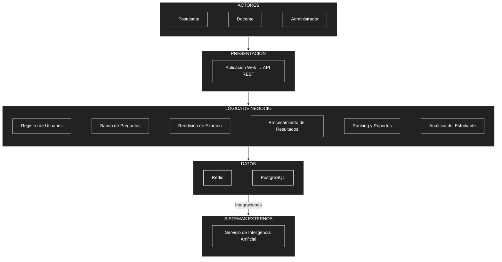

# Arquitectura inicial del sistema

## Diagrama de arquitectura

## Descripción

La arquitectura inicial se organiza en tres capas principales y un conjunto de sistemas externos:

- **Presentación:** permite la interacción de los usuarios con el sistema mediante la aplicación web y la API REST.
- **Lógica de negocio:** contiene los principales módulos responsables de las funcionalidades del sistema: registro de usuarios, banco de preguntas, rendición de examen, procesamiento de resultados, ranking y reportes, y analítica del estudiante.
- **Datos:** permite almacenar y consultar la información mediante Redis (almacenamiento temporal durante el examen) y PostgreSQL (almacenamiento definitivo).
- **Sistemas externos:** el servicio de inteligencia artificial, con el que el sistema se integra para generar las recomendaciones de refuerzo académico.

Además, el módulo de **Rendición de Examen** guarda las respuestas en **Redis**, y el módulo de **Procesamiento de Resultados** las calcula en segundo plano y las consolida en **PostgreSQL**.