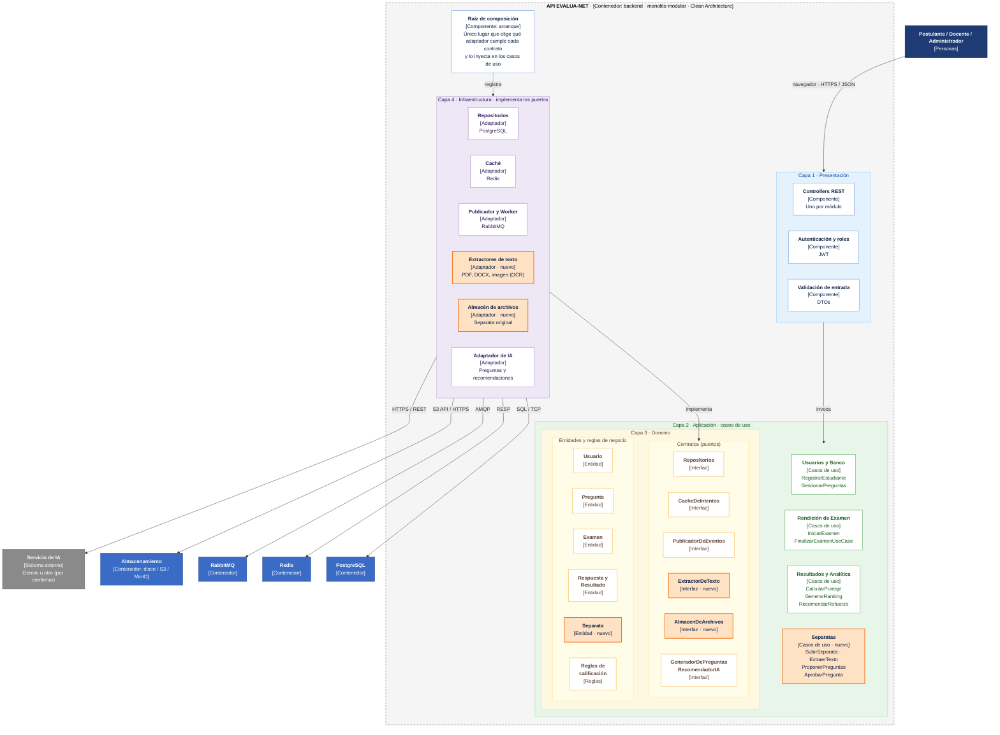

# Enfoque arquitectónico

**Proyecto:** EVALUA-NET – Sistema de simulacros de exámenes virtuales con IA – Academia Sofía

| **Elemento** | **Descripción aplicada a EVALUA-NET** |
|---|---|
| Patrón / enfoque arquitectónico | Clean Architecture (Arquitectura Limpia). |
| Objetivo | Separar las responsabilidades del sistema y controlar las dependencias hacia el dominio. |
| ¿Qué problema resuelve? | Evita el acoplamiento entre la interfaz web, las reglas del negocio de los simulacros y las tecnologías externas, como PostgreSQL, Redis, RabbitMQ y el servicio de inteligencia artificial. |
| Capas definidas | Presentación, Aplicación, Dominio e Infraestructura. |
| Beneficios | • Facilita el mantenimiento y las pruebas unitarias. • Permite cambiar tecnologías sin modificar las reglas del negocio. • Mejora la organización de los módulos y la separación de responsabilidades. |

## Diagrama de Clean Architecture

## Leyenda

- **Azul oscuro:** personas. **Azul:** contenedor. **Gris:** sistema externo. **Naranja:** componente nuevo por la carga de separatas.
- **Recuadro morado:** Infraestructura. **Recuadro azul claro:** Presentación. **Recuadro verde:** Aplicación. **Recuadros amarillos:** Dominio (contratos y entidades).
- **Flecha «invoca»:** la Presentación llama a los casos de uso.
- **Flecha «implementa»:** los adaptadores de Infraestructura implementan los puertos definidos en el Dominio (inversión de dependencias).
- **Flecha «registra» (punteada):** la raíz de composición elige y registra los adaptadores.
- **Flechas con protocolo:** conexión de los adaptadores con los sistemas externos.

## Notas

- Las dependencias apuntan hacia el dominio: Presentación → Aplicación → Dominio; la Infraestructura depende de los contratos del Dominio.
- Un módulo usa a otro solo a través de su interfaz pública (servicio), nunca sus tablas.
- La IA solo propone preguntas y recomendaciones; el docente aprueba y la nota oficial la calculan reglas deterministas.
- El proveedor de IA, el OCR y el almacenamiento de archivos están por definir y validar.

## Regla de dependencia

1. El Dominio no depende de las capas externas ni de tecnologías como PostgreSQL o Redis.
2. Los casos de uso de Aplicación trabajan con entidades e interfaces, sin conocer las implementaciones concretas.
3. Los repositorios y adaptadores de Infraestructura implementan los contratos definidos en las capas internas.
4. Cambiar PostgreSQL, Redis, RabbitMQ, el proveedor de IA, el OCR o el almacenamiento no debe requerir modificar las reglas del Dominio.
5. Todos los módulos del backend de EVALUA-NET seguirán esta organización para mantener una arquitectura uniforme.