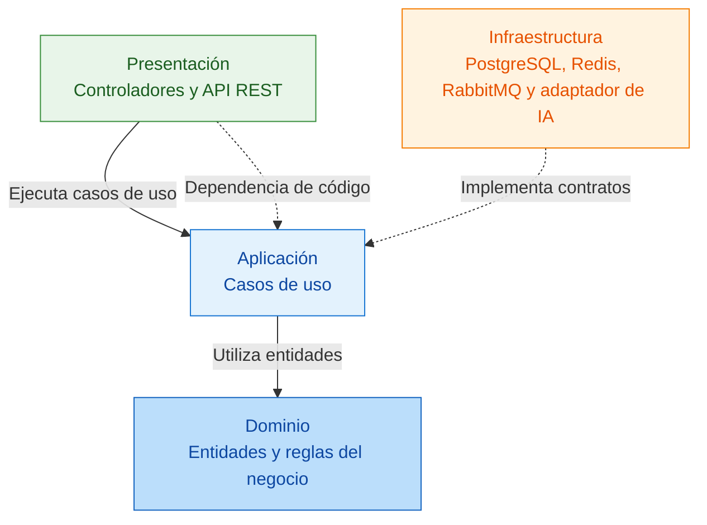

# Enfoque arquitectónico

**Proyecto:** EVALUA-NET – Sistema de simulacros de exámenes virtuales con IA – Academia Sofía

| **Elemento** | **Descripción aplicada a EVALUA-NET** |
|---|---|
| Patrón / enfoque arquitectónico | Clean Architecture (Arquitectura Limpia). |
| Objetivo | Separar las responsabilidades del sistema y controlar las dependencias hacia el dominio. |
| ¿Qué problema resuelve? | Evita el acoplamiento entre la interfaz web, las reglas del negocio de los simulacros y las tecnologías externas, como PostgreSQL, Redis, RabbitMQ y el servicio de inteligencia artificial. |
| Capas definidas | Presentación, Aplicación, Dominio e Infraestructura. |
| Beneficios | • Facilita el mantenimiento y las pruebas unitarias. • Permite cambiar tecnologías sin modificar las reglas del negocio. • Mejora la organización de los módulos y la separación de responsabilidades. |

## Diagrama de Clean Architecture

## Leyenda

- **Flecha continua:** llamada en tiempo de ejecución entre las capas.
- **Flecha punteada:** dependencia de código hacia las capas internas.
- **Flecha punteada de implementación:** la infraestructura implementa contratos definidos en las capas internas.
- **Capas:** el Dominio contiene las reglas del negocio; Aplicación coordina los casos de uso; Presentación e Infraestructura interactúan con usuarios y tecnologías.

## Regla de dependencia

1. El Dominio no depende de las capas externas ni de tecnologías como PostgreSQL o Redis.
2. Los casos de uso de Aplicación trabajan con entidades e interfaces, sin conocer las implementaciones concretas.
3. Los repositorios y adaptadores de Infraestructura implementan los contratos definidos en las capas internas.
4. Cambiar PostgreSQL, Redis, RabbitMQ o el proveedor de IA no debe requerir modificar las reglas del Dominio.
5. Todos los módulos del backend de EVALUA-NET seguirán esta organización para mantener una arquitectura uniforme.
