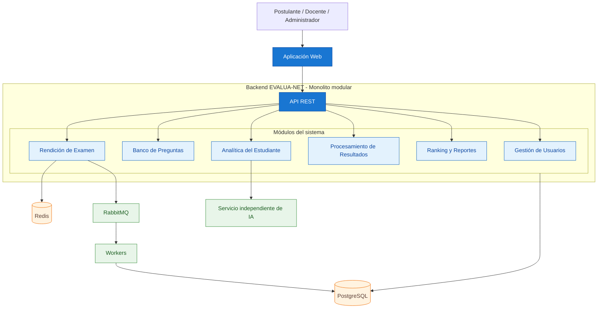

# Arquitectura del sistema EVALUA-NET

El sistema EVALUA-NET utiliza una **arquitectura de monolito modular con procesamiento asíncrono**, organizada mediante Clean Architecture.

El backend está dividido en seis módulos principales: Gestión de Usuarios, Banco de Preguntas, Rendición de Examen, Procesamiento de Resultados, Ranking y Reportes, y Analítica del Estudiante.

Utiliza PostgreSQL para almacenar información, Redis para las respuestas temporales y RabbitMQ con workers para procesar resultados de forma asíncrona. Además, se integra con un servicio independiente de inteligencia artificial.

## Diagrama de arquitectura

# Estilo arquitectónico

**Estilo seleccionado:** Monolito modular con procesamiento asíncrono.

El backend de EVALUA-NET se organiza en módulos independientes dentro de una sola aplicación, mientras que los workers ejecutan tareas de procesamiento en segundo plano y el servicio de IA funciona de manera independiente.

Esta decisión responde principalmente a los drivers **DA01 (Escalabilidad), DA02 (Rendimiento), DA07 (Procesamiento asíncrono) y DA10 (Mantenibilidad)**, y está registrada en **ADR-001**.

## Reglas de la arquitectura

1. Todos los módulos del negocio forman parte de una sola aplicación backend.
2. Cada módulo se organiza internamente mediante Clean Architecture.
3. Un módulo no accede directamente a los repositorios ni a las tablas de otro módulo.
4. La comunicación entre módulos se realiza mediante sus interfaces públicas.
5. Las tareas de procesamiento asíncrono se ejecutan mediante RabbitMQ y workers independientes.
6. El servicio de inteligencia artificial se mantiene separado del backend principal.
