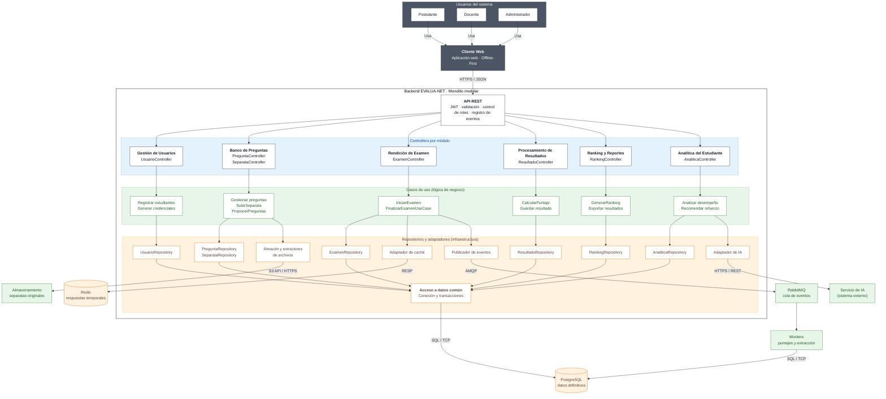

# Estilo arquitectónico

**Estilo seleccionado:** Monolito modular con procesamiento asíncrono.

El backend de EVALUA-NET se organiza en módulos independientes dentro de una sola aplicación, mientras que los workers ejecutan tareas de procesamiento en segundo plano y el servicio de IA funciona de manera independiente.

Esta decisión responde principalmente a los drivers **DA01 (Escalabilidad), DA02 (Rendimiento), DA07 (Procesamiento asíncrono) y DA10 (Mantenibilidad)**, y está registrada en **ADR-001**.

## Módulos del sistema

| Módulo | Responsabilidad |
|---|---|
| Gestión de Usuarios | Registro, credenciales, autenticación y roles. |
| Banco de Preguntas | Cursos, temas, preguntas y separatas de los docentes. |
| Rendición de Examen | Intentos, temporizador, examen y respuestas. |
| Procesamiento de Resultados | Calificación y persistencia de puntajes. |
| Ranking y Reportes | Clasificaciones y exportación de resultados. |
| Analítica del Estudiante | Desempeño, evolución e información para recomendaciones. |

## Diagrama del estilo arquitectónico

## Leyenda

- **Gris oscuro:** usuarios y cliente web. **Blanco con borde gris:** API y controllers.
- **Banda azul:** controllers por módulo. **Banda verde:** casos de uso. **Banda naranja:** repositorios y adaptadores de infraestructura.
- **Verde claro:** servicios que funcionan fuera del backend principal (RabbitMQ, workers, almacenamiento y servicio de IA).
- **Flecha:** relación en tiempo de ejecución; el texto indica el protocolo cuando corresponde.

## Reglas de la arquitectura

1. Todos los módulos del negocio forman parte de una sola aplicación backend.
2. Cada módulo se organiza internamente mediante Clean Architecture.
3. Un módulo no accede directamente a los repositorios ni a las tablas de otro módulo.
4. La comunicación entre módulos se realiza mediante sus interfaces públicas.
5. Las tareas de procesamiento asíncrono se ejecutan mediante RabbitMQ y workers independientes.
6. El servicio de inteligencia artificial se mantiene separado del backend principal.
7. Las separatas de los docentes se guardan fuera de la base de datos y su texto se extrae en segundo plano; la IA solo propone preguntas y el docente las aprueba.  