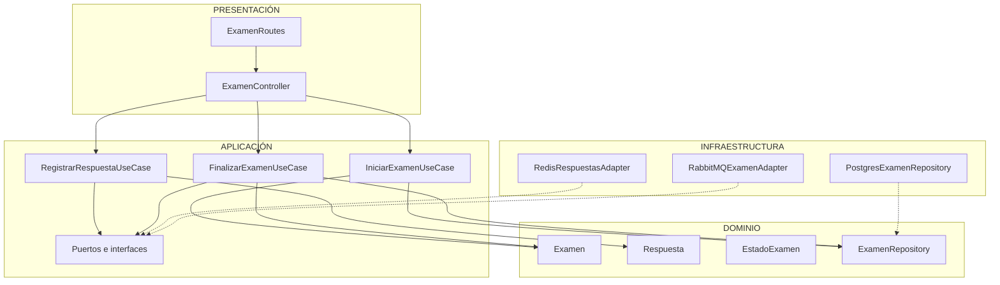
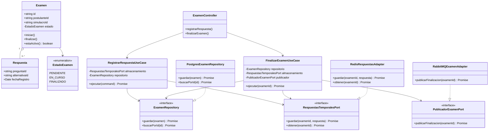
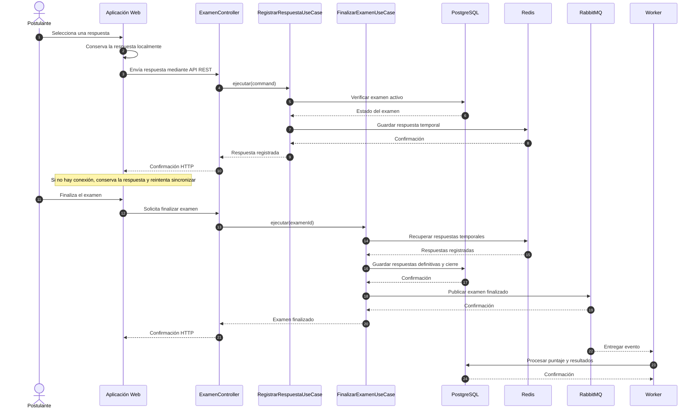

# Diseño interno de módulos

**Proyecto:** EVALUA-NET – Sistema de simulacros de exámenes virtuales con IA – Academia Sofía  
**Módulo de referencia:** Rendición de Examen  
**Tecnología de referencia:** Node.js + TypeScript  
**Enfoque arquitectónico:** Clean Architecture dentro del monolito modular  
**Nivel C4 relacionado:** Nivel 4 – Código  
**Versión:** 1.0


## 1. Propósito

Este documento describe cómo se organiza internamente el código del módulo Rendición de Examen del sistema EVALUA-NET.

Tiene tres objetivos principales:

- Establecer una estructura común para desarrollar los módulos del sistema.
- Separar las reglas del negocio de tecnologías como Redis, PostgreSQL y frameworks.
- Facilitar el mantenimiento, las pruebas y la incorporación de nuevas funcionalidades.

El módulo Rendición de Examen permite que los postulantes inicien simulacros, registren sus respuestas y finalicen sus evaluaciones.

Además, contempla el almacenamiento temporal de respuestas y su sincronización cuando existen problemas de conexión a internet.

## 2. Estructura de carpetas

El sistema utiliza un monolito modular. Cada módulo mantiene una organización interna basada en Clean Architecture.

Para el módulo Rendición de Examen se propone la siguiente estructura:

```text
src/
└── modules/
    └── rendicion-examen/
        ├── dominio/
        │   ├── examen.ts
        │   ├── respuesta.ts
        │   ├── estado-examen.ts
        │   └── examen-repository.ts
        │
        ├── aplicacion/
        │   ├── iniciar-examen.use-case.ts
        │   ├── registrar-respuesta.use-case.ts
        │   ├── finalizar-examen.use-case.ts
        │   ├── registrar-respuesta.command.ts
        │   ├── respuestas-temporales.port.ts
        │   └── publicador-examen.port.ts
        │
        ├── infraestructura/
        │   ├── postgres-examen-repository.ts
        │   ├── redis-respuestas.adapter.ts
        │   └── rabbitmq-examen.adapter.ts
        │
        ├── presentacion/
        │   ├── examen.controller.ts
        │   └── examen.routes.ts
        │
        ├── rendicion.module.ts
        └── index.ts
```

### 2.1. Responsabilidad de los archivos

| Archivo | Capa | Responsabilidad | Depende de |
|---|---|---|---|
| examen.ts | Dominio | Representar el examen y controlar sus estados. | Dominio |
| respuesta.ts | Dominio | Representar las respuestas del postulante. | Ninguna dependencia externa |
| estado-examen.ts | Dominio | Definir los estados del examen. | Ninguna |
| examen-repository.ts | Dominio | Declarar operaciones para consultar y guardar exámenes. | Dominio |
| iniciar-examen.use-case.ts | Aplicación | Validar e iniciar un simulacro. | Dominio |
| registrar-respuesta.use-case.ts | Aplicación | Coordinar el registro de respuestas. | Dominio y puertos |
| finalizar-examen.use-case.ts | Aplicación | Finalizar el examen y solicitar su procesamiento. | Dominio y puertos |
| registrar-respuesta.command.ts | Aplicación | Definir los datos necesarios para registrar una respuesta. | Ninguna |
| respuestas-temporales.port.ts | Aplicación | Definir operaciones para almacenar y recuperar respuestas temporales. | Dominio |
| publicador-examen.port.ts | Aplicación | Definir la publicación de exámenes finalizados. | Ninguna tecnología concreta |
| postgres-examen-repository.ts | Infraestructura | Implementar la persistencia definitiva con PostgreSQL. | Contratos internos y PostgreSQL |
| redis-respuestas.adapter.ts | Infraestructura | Implementar almacenamiento temporal con Redis. | Puerto y Redis |
| rabbitmq-examen.adapter.ts | Infraestructura | Publicar eventos mediante RabbitMQ. | Puerto y RabbitMQ |
| examen.controller.ts | Presentación | Recibir solicitudes HTTP y ejecutar casos de uso. | Aplicación |
| examen.routes.ts | Presentación | Definir las rutas REST del módulo. | Presentación |
| rendicion.module.ts | Composición | Conectar casos de uso, repositorios y adaptadores. | Todas las capas |
| index.ts | Composición | Exponer las funcionalidades públicas del módulo. | Composición |

Esta organización permite que cada archivo tenga una responsabilidad específica y evita mezclar reglas del negocio con detalles tecnológicos.

## 3. Capas del módulo y regla de dependencia

El módulo Rendición de Examen aplica las cuatro capas de Clean Architecture.

### 3.1. Diagrama de capas



**Descripción:** El diagrama muestra la organización interna del módulo. Presentación utiliza los casos de uso de Aplicación, mientras que Infraestructura implementa los contratos definidos en las capas internas.

Las flechas continuas representan dependencias de uso y las discontinuas representan implementaciones de contratos.

### 3.2. Reglas de dependencia

| Capa | Contiene | Puede depender de | No debe depender de |
|---|---|---|---|
| Dominio | Entidades, reglas y contratos de negocio. | Elementos del propio dominio. | Aplicación, Presentación, Infraestructura y frameworks. |
| Aplicación | Casos de uso, comandos y puertos. | Dominio. | Redis, RabbitMQ, PostgreSQL y controladores HTTP. |
| Infraestructura | Repositorios y adaptadores tecnológicos. | Contratos internos y librerías externas. | Controladores de Presentación. |
| Presentación | Controladores y rutas REST. | Aplicación. | Implementaciones concretas de persistencia. |
| Composición | Configuración e inyección de dependencias. | Todas las capas. | No aplica. |

**Regla principal:** Las dependencias del código deben apuntar hacia las capas internas. El Dominio no debe conocer las tecnologías utilizadas para almacenar datos o comunicarse con otros componentes.

## 4. Diagrama de clases

El siguiente diagrama representa las principales clases e interfaces propuestas para el módulo Rendición de Examen.



### 4.1. Notación UML utilizada

| Símbolo | Significado |
|---|---|
| Línea continua con flecha | Asociación o dependencia de uso. |
| Línea discontinua con triángulo | Implementación de una interfaz. |
| Rombo vacío | Agregación entre elementos. |
| `<<interface>>` | Contrato que debe implementar otra clase. |
| `<<enumeration>>` | Conjunto de valores permitidos. |
| `+` | Atributo o método público. |
| `-` | Atributo o método privado. |

El diagrama permite identificar las clases principales y comprender cómo los casos de uso utilizan interfaces en lugar de depender directamente de Redis, PostgreSQL o RabbitMQ.

## 5. Flujo de ejecución: registrar y finalizar examen

Este flujo describe cómo el sistema registra las respuestas de un postulante y solicita el procesamiento del examen cuando finaliza.

### 5.1. Diagrama de secuencia



**Descripción:** Durante el examen, las respuestas se conservan temporalmente en Redis y también en el almacenamiento local del navegador para soportar problemas de conexión.

Al finalizar, las respuestas se consolidan en PostgreSQL y se publica un evento en RabbitMQ para que un worker realice el procesamiento correspondiente.

El sistema debe evitar confirmar el cierre mientras existan respuestas locales pendientes de sincronización. También debe impedir respuestas posteriores al cierre autorizado.

### 5.2. Pasos del flujo

| Paso | Origen → Destino | Acción | Capa |
|---|---|---|---|
| 1 | Postulante → Web | Selecciona una alternativa. | Presentación |
| 2 | Web → Controlador | Envía la respuesta mediante API REST. | Presentación |
| 3 | Controlador → Caso de uso | Solicita registrar la respuesta. | Presentación → Aplicación |
| 4 | Caso de uso → Repositorio | Verifica que el examen esté activo. | Aplicación → Dominio |
| 5 | Caso de uso → Redis | Guarda temporalmente la respuesta. | Aplicación → Infraestructura mediante puerto |
| 6 | Redis → Web | Confirma el registro. | Infraestructura → Presentación |
| 7 | Postulante → Web | Solicita finalizar el examen. | Presentación |
| 8 | Web → Caso de uso | Solicita el cierre del examen. | Presentación → Aplicación |
| 9 | Caso de uso → Redis | Recupera las respuestas. | Aplicación → Infraestructura |
| 10 | Caso de uso → PostgreSQL | Guarda las respuestas definitivas y el cierre. | Aplicación → Infraestructura |
| 11 | Caso de uso → RabbitMQ | Publica el evento de finalización. | Aplicación → Infraestructura |
| 12 | RabbitMQ → Worker | Entrega el evento para procesar resultados. | Infraestructura |
| 13 | Worker → PostgreSQL | Almacena los resultados calculados. | Infraestructura y Aplicación |

**Consideración:** La confirmación de la finalización debe garantizar que el evento de procesamiento no se pierda. Para una implementación real se puede utilizar el patrón Transactional Outbox.

El cálculo de la nota individual deberá realizarse con la rapidez necesaria para cumplir el requisito de resultados inmediatos. El ranking general puede actualizarse de manera asíncrona.

## 6. Código de referencia

Los siguientes ejemplos utilizan TypeScript para mostrar cómo podría implementarse el módulo.

No representan todavía código ejecutable completo ni una tecnología definitivamente seleccionada.

### 6.1. Dominio: entidad Examen

Archivo: `dominio/examen.ts`

```typescript
export enum EstadoExamen {
  PENDIENTE = "PENDIENTE",
  EN_CURSO = "EN_CURSO",
  FINALIZADO = "FINALIZADO"
}

export class Examen {
  constructor(
    public readonly id: string,
    public readonly postulanteId: string,
    public readonly simulacroId: string,
    private estado: EstadoExamen
  ) {}

  iniciar(): void {
    if (this.estado !== EstadoExamen.PENDIENTE) {
      throw new Error("El examen no puede iniciarse");
    }

    this.estado = EstadoExamen.EN_CURSO;
  }

  finalizar(): void {
    if (this.estado !== EstadoExamen.EN_CURSO) {
      throw new Error("El examen no está activo");
    }

    this.estado = EstadoExamen.FINALIZADO;
  }

  estaActivo(): boolean {
    return this.estado === EstadoExamen.EN_CURSO;
  }
}
```

**Explicación:** La entidad Examen contiene las reglas relacionadas con el inicio, desarrollo y finalización del simulacro. No depende de ninguna base de datos ni framework.

### 6.2. Aplicación: puerto de almacenamiento temporal

Archivo: `aplicacion/respuestas-temporales.port.ts`

```typescript
export interface RespuestaTemporal {
  preguntaId: string;
  alternativaId: string;
}

export interface RespuestasTemporalesPort {
  guardar(
    examenId: string,
    respuesta: RespuestaTemporal
  ): Promise<void>;

  obtener(
    examenId: string
  ): Promise<RespuestaTemporal[]>;
}
```

**Explicación:** Esta interfaz define las operaciones necesarias para almacenar y recuperar respuestas, sin indicar qué tecnología se utilizará.

### 6.3. Aplicación: caso de uso RegistrarRespuesta

Archivo: `aplicacion/registrar-respuesta.use-case.ts`

```typescript
import { RespuestasTemporalesPort } from "./respuestas-temporales.port";
import { ExamenRepository } from "../dominio/examen-repository";

export interface RegistrarRespuestaCommand {
  examenId: string;
  preguntaId: string;
  alternativaId: string;
}

export class RegistrarRespuestaUseCase {
  constructor(
    private readonly repositorio: ExamenRepository,
    private readonly almacenamiento: RespuestasTemporalesPort
  ) {}

  async ejecutar(
    command: RegistrarRespuestaCommand
  ): Promise<void> {

    const examen = await this.repositorio.buscarPorId(
      command.examenId
    );

    if (!examen || !examen.estaActivo()) {
      throw new Error("El examen no está activo");
    }

    await this.almacenamiento.guardar(
      command.examenId,
      {
        preguntaId: command.preguntaId,
        alternativaId: command.alternativaId
      }
    );
  }
}
```

**Explicación:** El caso de uso verifica que el examen esté activo y coordina el registro de respuestas. Utiliza interfaces para evitar depender directamente de Redis o PostgreSQL.

En una implementación real también deberá validar que el examen pertenezca al postulante autenticado, que la pregunta corresponda al simulacro y que el plazo permitido no haya vencido.

### 6.4. Infraestructura: adaptador Redis

Archivo: `infraestructura/redis-respuestas.adapter.ts`

```typescript
import {
  RespuestasTemporalesPort,
  RespuestaTemporal
} from "../aplicacion/respuestas-temporales.port";

export interface RedisClientPort {
  hSet(
    key: string,
    field: string,
    value: string
  ): Promise<number>;

  hVals(key: string): Promise<string[]>;
}

export class RedisRespuestasAdapter
  implements RespuestasTemporalesPort {

  constructor(
    private readonly redis: RedisClientPort
  ) {}

  async guardar(
    examenId: string,
    respuesta: RespuestaTemporal
  ): Promise<void> {

    await this.redis.hSet(
      `examen:${examenId}:respuestas`,
      respuesta.preguntaId,
      JSON.stringify(respuesta)
    );
  }

  async obtener(
    examenId: string
  ): Promise<RespuestaTemporal[]> {

    const datos = await this.redis.hVals(
      `examen:${examenId}:respuestas`
    );

    return datos.map(
      dato => JSON.parse(dato) as RespuestaTemporal
    );
  }
}
```

**Explicación:** Este adaptador implementa el almacenamiento temporal mediante Redis. Utiliza un Hash donde cada pregunta tiene una respuesta asociada, permitiendo actualizarla mientras el examen permanezca activo.

En producción deberán definirse controles de concurrencia, expiración y recuperación para evitar la pérdida de respuestas.

### 6.5. Presentación: controlador REST

Archivo: `presentacion/examen.controller.ts`

```typescript
import {
  RegistrarRespuestaUseCase
} from "../aplicacion/registrar-respuesta.use-case";

export class ExamenController {
  constructor(
    private readonly registrarRespuesta:
      RegistrarRespuestaUseCase
  ) {}

  async registrar(
    examenId: string,
    preguntaId: string,
    alternativaId: string
  ): Promise<void> {

    await this.registrarRespuesta.ejecutar({
      examenId,
      preguntaId,
      alternativaId
    });
  }
}
```

**Explicación:** El controlador recibe los datos de la solicitud y llama al caso de uso. La traducción de solicitudes HTTP, la autenticación y los códigos de respuesta se agregarán mediante el framework seleccionado.

### 6.6. Raíz de composición

Archivo: `rendicion.module.ts`

```typescript
import { RegistrarRespuestaUseCase }
  from "./aplicacion/registrar-respuesta.use-case";

import { RedisRespuestasAdapter }
  from "./infraestructura/redis-respuestas.adapter";

import { PostgresExamenRepository }
  from "./infraestructura/postgres-examen-repository";

import { ExamenController }
  from "./presentacion/examen.controller";

export function crearModuloRendicion(
  db: unknown,
  redis: unknown
) {
  // Referencia conceptual: requiere adaptar
  // los tipos y constructores concretos.

  const repositorio =
    new PostgresExamenRepository(db);

  const almacenamiento =
    new RedisRespuestasAdapter(redis);

  const registrarRespuesta =
    new RegistrarRespuestaUseCase(
      repositorio,
      almacenamiento
    );

  return {
    controller: new ExamenController(
      registrarRespuesta
    )
  };
}
```

**Explicación:** La raíz de composición conecta las implementaciones concretas con los casos de uso. De esta manera, las clases de Aplicación no necesitan conocer las tecnologías utilizadas.

Este fragmento es ilustrativo: `PostgresExamenRepository` y los tipos de conexión deben implementarse antes de compilarlo.

