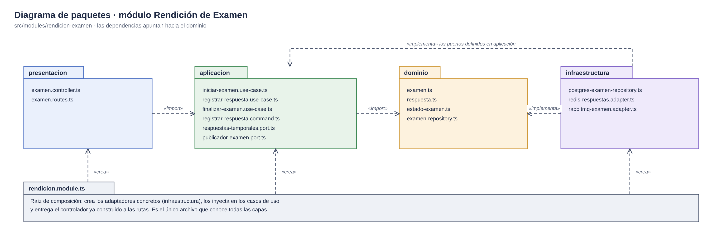
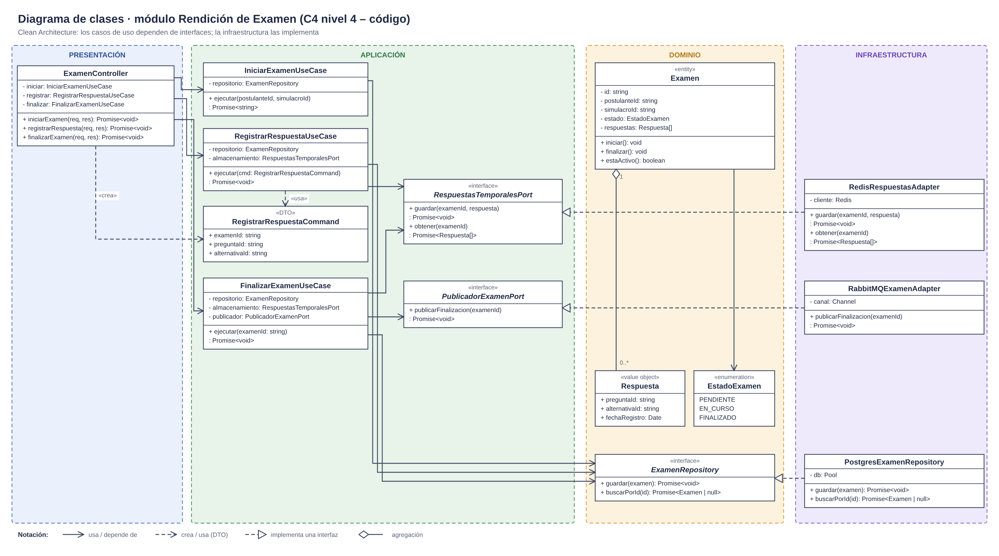
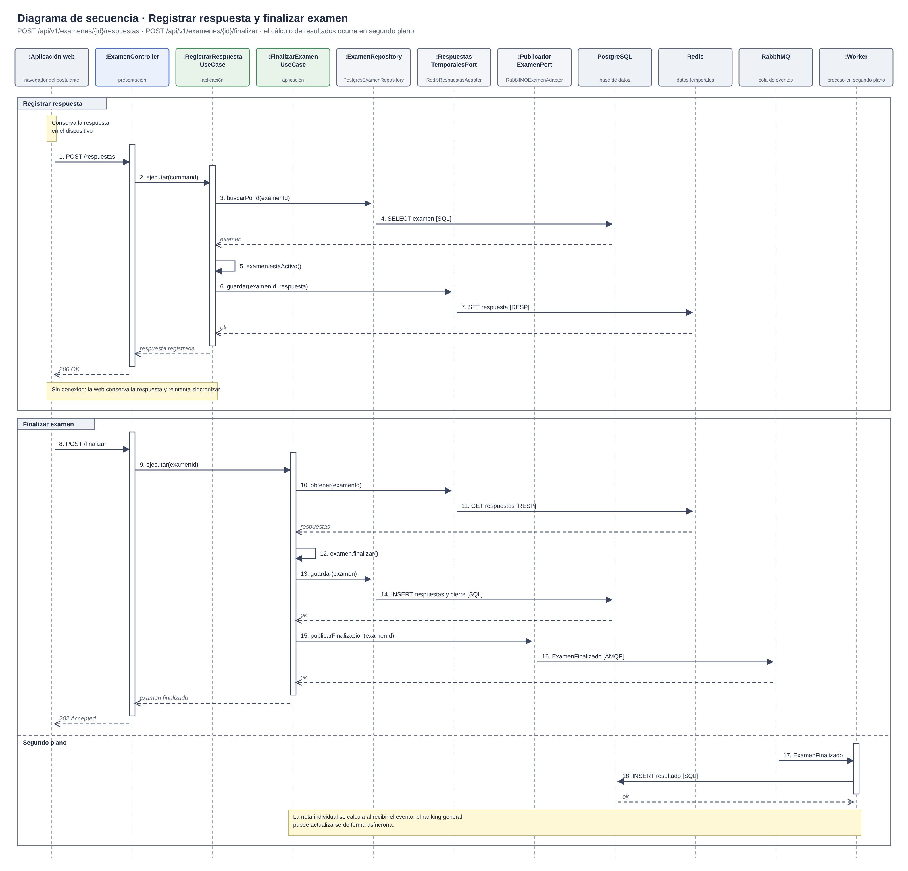
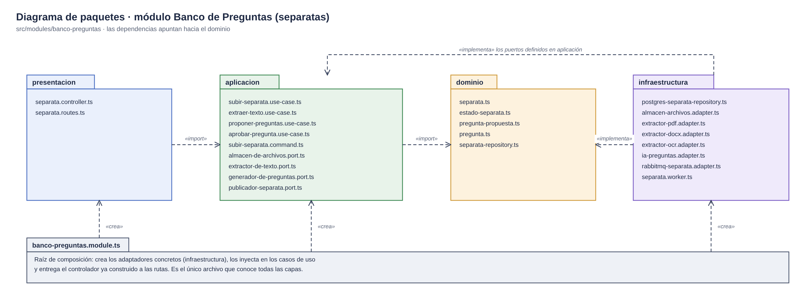
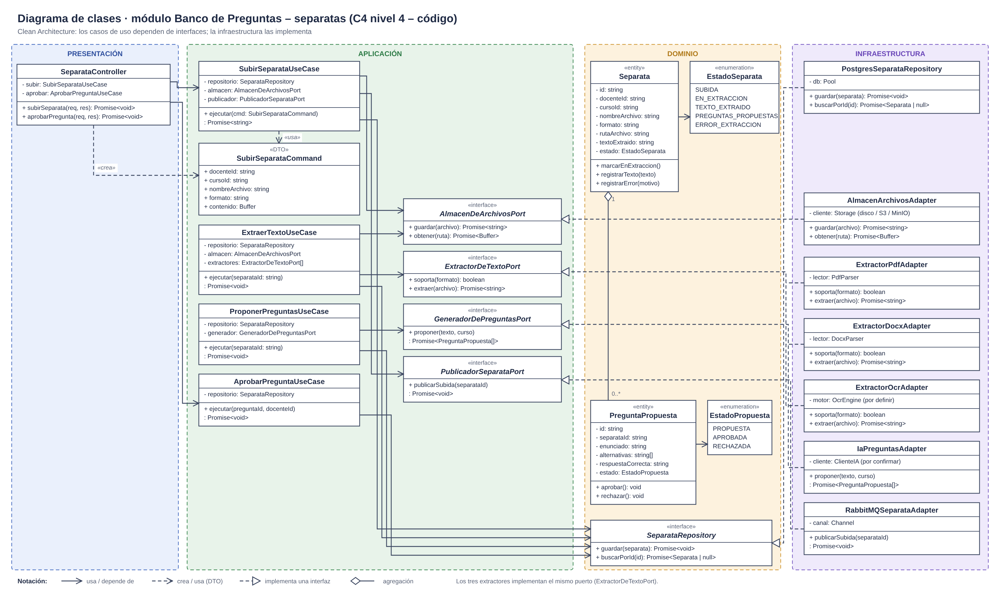
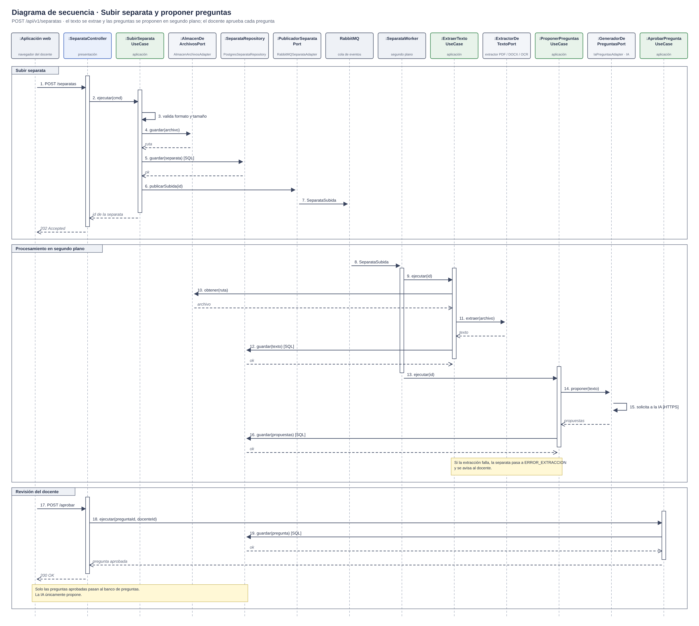

# Diseño interno de módulos

**Proyecto:** EVALUA-NET – Sistema de simulacros de exámenes virtuales con IA – Academia Sofía  
**Módulos de referencia:** Rendición de Examen y Banco de Preguntas (separatas)  
**Tecnología de referencia:** Node.js + TypeScript  
**Enfoque arquitectónico:** Clean Architecture dentro del monolito modular  
**Nivel C4 relacionado:** Nivel 4 – Código  
**Versión:** 1.2


## 1. Propósito

Este documento describe cómo se organiza internamente el código de los módulos Rendición de Examen y Banco de Preguntas del sistema EVALUA-NET.

Tiene tres objetivos principales:

- Establecer una estructura común para desarrollar los módulos del sistema.
- Separar las reglas del negocio de tecnologías como Redis, PostgreSQL y frameworks.
- Facilitar el mantenimiento, las pruebas y la incorporación de nuevas funcionalidades.

El módulo Rendición de Examen permite que los postulantes inicien simulacros, registren sus respuestas y finalicen sus evaluaciones.

Además, contempla el almacenamiento temporal de respuestas y su sincronización cuando existen problemas de conexión a internet.

El módulo Banco de Preguntas se describe en la sección 6, porque incorpora la carga de separatas por parte de los docentes y la generación de preguntas con apoyo de IA.

## 2. Estructura de carpetas

El sistema utiliza un monolito modular. Cada módulo mantiene una organización interna basada en Clean Architecture.

Para el módulo Rendición de Examen se propone la siguiente estructura:

```text
src/
└── modules/
    └── rendicion-examen/
        ├── dominio/
        │   ├── examen.ts
        │   ├── respuesta.ts
        │   ├── estado-examen.ts
        │   └── examen-repository.ts
        │
        ├── aplicacion/
        │   ├── iniciar-examen.use-case.ts
        │   ├── registrar-respuesta.use-case.ts
        │   ├── finalizar-examen.use-case.ts
        │   ├── registrar-respuesta.command.ts
        │   ├── respuestas-temporales.port.ts
        │   └── publicador-examen.port.ts
        │
        ├── infraestructura/
        │   ├── postgres-examen-repository.ts
        │   ├── redis-respuestas.adapter.ts
        │   └── rabbitmq-examen.adapter.ts
        │
        ├── presentacion/
        │   ├── examen.controller.ts
        │   └── examen.routes.ts
        │
        ├── rendicion.module.ts
        └── index.ts
```

### 2.1. Responsabilidad de los archivos

| Archivo | Capa | Responsabilidad | Depende de |
|---|---|---|---|
| examen.ts | Dominio | Representar el examen y controlar sus estados. | Dominio |
| respuesta.ts | Dominio | Representar las respuestas del postulante. | Ninguna dependencia externa |
| estado-examen.ts | Dominio | Definir los estados del examen. | Ninguna |
| examen-repository.ts | Dominio | Declarar operaciones para consultar y guardar exámenes. | Dominio |
| iniciar-examen.use-case.ts | Aplicación | Validar e iniciar un simulacro. | Dominio |
| registrar-respuesta.use-case.ts | Aplicación | Coordinar el registro de respuestas. | Dominio y puertos |
| finalizar-examen.use-case.ts | Aplicación | Finalizar el examen y solicitar su procesamiento. | Dominio y puertos |
| registrar-respuesta.command.ts | Aplicación | Definir los datos necesarios para registrar una respuesta. | Ninguna |
| respuestas-temporales.port.ts | Aplicación | Definir operaciones para almacenar y recuperar respuestas temporales. | Dominio |
| publicador-examen.port.ts | Aplicación | Definir la publicación de exámenes finalizados. | Ninguna tecnología concreta |
| postgres-examen-repository.ts | Infraestructura | Implementar la persistencia definitiva con PostgreSQL. | Contratos internos y PostgreSQL |
| redis-respuestas.adapter.ts | Infraestructura | Implementar almacenamiento temporal con Redis. | Puerto y Redis |
| rabbitmq-examen.adapter.ts | Infraestructura | Publicar eventos mediante RabbitMQ. | Puerto y RabbitMQ |
| examen.controller.ts | Presentación | Recibir solicitudes HTTP y ejecutar casos de uso. | Aplicación |
| examen.routes.ts | Presentación | Definir las rutas REST del módulo. | Presentación |
| rendicion.module.ts | Composición | Conectar casos de uso, repositorios y adaptadores. | Todas las capas |
| index.ts | Composición | Exponer las funcionalidades públicas del módulo. | Composición |

Esta organización permite que cada archivo tenga una responsabilidad específica y evita mezclar reglas del negocio con detalles tecnológicos.

## 3. Capas del módulo y regla de dependencia

El módulo Rendición de Examen aplica las cuatro capas de Clean Architecture.

### 3.1. Diagrama de paquetes



**Descripción:** El diagrama muestra los paquetes del módulo y sus dependencias. Presentación importa Aplicación, Aplicación importa Dominio e Infraestructura implementa los contratos definidos en las capas internas: el repositorio en Dominio y los puertos en Aplicación. El archivo `rendicion.module.ts` es la raíz de composición: crea los adaptadores concretos, los inyecta en los casos de uso y es el único que conoce todas las capas.

### 3.2. Reglas de dependencia

| Capa | Contiene | Puede depender de | No debe depender de |
|---|---|---|---|
| Dominio | Entidades, reglas y contratos de negocio. | Elementos del propio dominio. | Aplicación, Presentación, Infraestructura y frameworks. |
| Aplicación | Casos de uso, comandos y puertos. | Dominio. | Redis, RabbitMQ, PostgreSQL y controladores HTTP. |
| Infraestructura | Repositorios y adaptadores tecnológicos. | Contratos internos y librerías externas. | Controladores de Presentación. |
| Presentación | Controladores y rutas REST. | Aplicación. | Implementaciones concretas de persistencia. |
| Composición | Configuración e inyección de dependencias. | Todas las capas. | No aplica. |

**Regla principal:** Las dependencias del código deben apuntar hacia las capas internas. El Dominio no debe conocer las tecnologías utilizadas para almacenar datos o comunicarse con otros componentes.

## 4. Diagrama de clases

El siguiente diagrama representa las principales clases e interfaces propuestas para el módulo Rendición de Examen, organizadas por capa.



### 4.1. Notación UML utilizada

| Símbolo | Significado |
|---|---|
| Línea continua con flecha | Asociación o dependencia de uso. |
| Línea discontinua con flecha | Creación o uso de un objeto de transferencia (DTO). |
| Línea discontinua con triángulo | Implementación de una interfaz. |
| Rombo vacío | Agregación entre elementos. |
| `«interface»` | Contrato que debe implementar otra clase. |
| `«enumeration»` | Conjunto de valores permitidos. |
| `«entity»` y `«value object»` | Objeto del dominio con identidad y objeto del dominio sin identidad propia. |
| `«DTO»` | Objeto que solo transporta datos entre capas. |
| `+` y `-` | Atributo o método público y privado. |

El diagrama permite identificar las clases principales y comprender cómo los casos de uso utilizan interfaces en lugar de depender directamente de Redis, PostgreSQL o RabbitMQ.

## 5. Flujo de ejecución: registrar y finalizar examen

Este flujo describe cómo el sistema registra las respuestas de un postulante y solicita el procesamiento del examen cuando finaliza.

### 5.1. Diagrama de secuencia



**Descripción:** Durante el examen, las respuestas se conservan temporalmente en Redis y también en el almacenamiento local del navegador para soportar problemas de conexión.

Al finalizar, las respuestas se consolidan en PostgreSQL y se publica un evento en RabbitMQ para que un worker realice el procesamiento correspondiente.

El sistema debe evitar confirmar el cierre mientras existan respuestas locales pendientes de sincronización. También debe impedir respuestas posteriores al cierre autorizado.

### 5.2. Pasos del flujo

| Paso | Origen → Destino | Acción | Capa |
|---|---|---|---|
| 1 | Postulante → Web | Selecciona una alternativa. | Presentación |
| 2 | Web → Controlador | Envía la respuesta mediante API REST. | Presentación |
| 3 | Controlador → Caso de uso | Solicita registrar la respuesta. | Presentación → Aplicación |
| 4 | Caso de uso → Repositorio | Verifica que el examen esté activo mediante el contrato ExamenRepository. | Aplicación → Dominio (implementado en Infraestructura) |
| 5 | Caso de uso → Redis | Guarda temporalmente la respuesta. | Aplicación → Infraestructura mediante puerto |
| 6 | Caso de uso → Controlador → Web | Confirma el registro de la respuesta. | Aplicación → Presentación |
| 7 | Postulante → Web | Solicita finalizar el examen. | Presentación |
| 8 | Web → Controlador → Caso de uso | Solicita el cierre del examen. | Presentación → Aplicación |
| 9 | Caso de uso → Redis | Recupera las respuestas. | Aplicación → Infraestructura |
| 10 | Caso de uso → PostgreSQL | Guarda las respuestas definitivas y el cierre. | Aplicación → Infraestructura |
| 11 | Caso de uso → RabbitMQ | Publica el evento de finalización. | Aplicación → Infraestructura |
| 12 | RabbitMQ → Worker | Entrega el evento para procesar resultados. | Infraestructura |
| 13 | Worker → PostgreSQL | Almacena los resultados calculados. | Infraestructura y Aplicación |

**Consideración:** La confirmación de la finalización debe garantizar que el evento de procesamiento no se pierda. Para una implementación real se puede utilizar el patrón Transactional Outbox.

El cálculo de la nota individual deberá realizarse con la rapidez necesaria para cumplir el requisito de resultados inmediatos. El ranking general puede actualizarse de manera asíncrona.

## 6. Módulo Banco de Preguntas: carga de separatas

Los docentes pueden subir separatas en distintos formatos (PDF, DOCX e imágenes). El sistema guarda el archivo original, extrae su texto en segundo plano y la IA propone preguntas a partir de él. Las preguntas propuestas solo pasan al banco cuando el docente las aprueba.

La extracción de texto puede tardar, sobre todo con imágenes (OCR). Por eso se procesa de forma asíncrona, igual que el cálculo de resultados en el módulo Rendición de Examen.

### 6.1. Estructura de carpetas

```text
src/
└── modules/
    └── banco-preguntas/
        ├── dominio/
        │   ├── pregunta.ts
        │   ├── separata.ts
        │   ├── estado-separata.ts
        │   ├── pregunta-propuesta.ts
        │   └── separata-repository.ts
        │
        ├── aplicacion/
        │   ├── subir-separata.use-case.ts
        │   ├── extraer-texto.use-case.ts
        │   ├── proponer-preguntas.use-case.ts
        │   ├── aprobar-pregunta.use-case.ts
        │   ├── subir-separata.command.ts
        │   ├── almacen-de-archivos.port.ts
        │   ├── extractor-de-texto.port.ts
        │   ├── generador-de-preguntas.port.ts
        │   └── publicador-separata.port.ts
        │
        ├── infraestructura/
        │   ├── postgres-separata-repository.ts
        │   ├── almacen-archivos.adapter.ts
        │   ├── extractor-pdf.adapter.ts
        │   ├── extractor-docx.adapter.ts
        │   ├── extractor-ocr.adapter.ts
        │   ├── ia-preguntas.adapter.ts
        │   ├── rabbitmq-separata.adapter.ts
        │   └── separata.worker.ts
        │
        ├── presentacion/
        │   ├── separata.controller.ts
        │   └── separata.routes.ts
        │
        ├── banco-preguntas.module.ts
        └── index.ts
```

### 6.2. Responsabilidad de los archivos

| Archivo | Capa | Responsabilidad | Depende de |
|---|---|---|---|
| separata.ts | Dominio | Representar la separata, su archivo, su texto extraído y su estado. | Dominio |
| estado-separata.ts | Dominio | Definir los estados de la separata. | Ninguna |
| pregunta-propuesta.ts | Dominio | Representar una pregunta generada por IA pendiente de aprobación. | Dominio |
| pregunta.ts | Dominio | Representar la pregunta aprobada que forma parte del banco. | Dominio |
| separata-repository.ts | Dominio | Declarar operaciones para consultar y guardar separatas y propuestas. | Dominio |
| subir-separata.use-case.ts | Aplicación | Validar el archivo, guardarlo y solicitar su procesamiento. | Dominio y puertos |
| extraer-texto.use-case.ts | Aplicación | Obtener el texto de la separata mediante el extractor adecuado. | Dominio y puertos |
| proponer-preguntas.use-case.ts | Aplicación | Solicitar preguntas a la IA y registrarlas como propuestas. | Dominio y puertos |
| aprobar-pregunta.use-case.ts | Aplicación | Permitir que el docente apruebe o rechace cada propuesta. | Dominio |
| subir-separata.command.ts | Aplicación | Definir los datos necesarios para subir una separata. | Ninguna |
| almacen-de-archivos.port.ts | Aplicación | Definir cómo guardar y obtener el archivo original. | Ninguna tecnología concreta |
| extractor-de-texto.port.ts | Aplicación | Definir cómo se extrae texto de un archivo, sin conocer su formato. | Ninguna tecnología concreta |
| generador-de-preguntas.port.ts | Aplicación | Definir cómo se generan preguntas a partir de un texto. | Ninguna tecnología concreta |
| publicador-separata.port.ts | Aplicación | Definir la publicación del evento SeparataSubida. | Ninguna tecnología concreta |
| postgres-separata-repository.ts | Infraestructura | Implementar la persistencia definitiva con PostgreSQL. | Contratos internos y PostgreSQL |
| almacen-archivos.adapter.ts | Infraestructura | Guardar la separata original en disco, S3 o MinIO (por definir). | Puerto y almacenamiento |
| extractor-pdf.adapter.ts | Infraestructura | Extraer el texto de PDF que ya contienen texto. | Puerto y librería de PDF |
| extractor-docx.adapter.ts | Infraestructura | Extraer el texto de documentos DOCX. | Puerto y librería de DOCX |
| extractor-ocr.adapter.ts | Infraestructura | Extraer texto de imágenes y PDF escaneados mediante OCR (por definir). | Puerto y motor OCR |
| ia-preguntas.adapter.ts | Infraestructura | Solicitar preguntas al servicio de IA (proveedor por confirmar). | Puerto y servicio de IA |
| rabbitmq-separata.adapter.ts | Infraestructura | Publicar el evento SeparataSubida en RabbitMQ. | Puerto y RabbitMQ |
| separata.worker.ts | Infraestructura | Consumir el evento y ejecutar la extracción y la propuesta de preguntas. | Casos de uso y RabbitMQ |
| separata.controller.ts | Presentación | Recibir el archivo y registrar la aprobación de preguntas. | Aplicación |
| separata.routes.ts | Presentación | Definir las rutas REST de separatas. | Presentación |
| banco-preguntas.module.ts | Composición | Conectar casos de uso, repositorios y adaptadores. | Todas las capas |
| index.ts | Composición | Exponer las funcionalidades públicas del módulo. | Composición |

Hay un extractor por formato, y todos cumplen el mismo contrato `ExtractorDeTextoPort`. Así, agregar un formato nuevo solo requiere un adaptador nuevo, sin cambiar los casos de uso.

### 6.3. Diagrama de paquetes



### 6.4. Estados

| Elemento | Estados |
|---|---|
| Separata | SUBIDA → EN_EXTRACCION → TEXTO_EXTRAIDO → PREGUNTAS_PROPUESTAS (o ERROR_EXTRACCION). |
| Pregunta propuesta | PROPUESTA → APROBADA o RECHAZADA. Solo las aprobadas pasan al banco de preguntas. |

### 6.5. Diagrama de clases



**Descripción:** Los casos de uso dependen de interfaces (puertos), no de la IA, del OCR ni del almacenamiento. Los tres extractores implementan el mismo puerto `ExtractorDeTextoPort`.

### 6.6. Diagrama de secuencia: subir una separata y proponer preguntas



**Descripción:** El docente recibe la confirmación apenas se guarda el archivo. La extracción y la generación de preguntas ocurren después, en un worker, porque el OCR puede tardar. Al final, el docente revisa las preguntas propuestas y aprueba las que desea incorporar al banco.

### 6.7. Consideraciones

- La IA solo propone preguntas; ninguna entra al banco sin la aprobación del docente.
- Se debe validar el formato y el tamaño del archivo antes de guardarlo.
- Se admiten DOCX, PDF, JPG, JPEG y PNG. El docente convierte los archivos `.doc` antiguos a `.docx` antes de subirlos. El tamaño máximo por archivo es configurable, con un valor inicial de 20 MB (RF15, CA-BP02).
- Si la extracción falla, la separata pasa a `ERROR_EXTRACCION`. El docente consulta el estado y el motivo en el módulo (CA-BP03).
- Conviene que el worker sea idempotente, para que un evento repetido no genere preguntas duplicadas.
- ADR-010 a ADR-012 establecen Gemini mediante ServicioIA para la lectura multimodal y AlmacenArchivos para los originales. Solo se transfiere contenido académico autorizado, excluyendo datos personales, credenciales e información confidencial.

## Reglas aprobadas de Rendición de Examen

La [SDD de Rendición](../../specs/rendicion-examen/spec.md#decisiones-aprobadas) fija el intento único, el plazo del servidor, el cierre automático con respuestas confirmadas y la recuperación del estado vigente al reconectar (RF04–RF06, AC07). La modalidad impresa usa el número de pregunta de la versión congelada. El registro, cambio y borrado usan revisiones para protegerse frente a reintentos y concurrencia.
