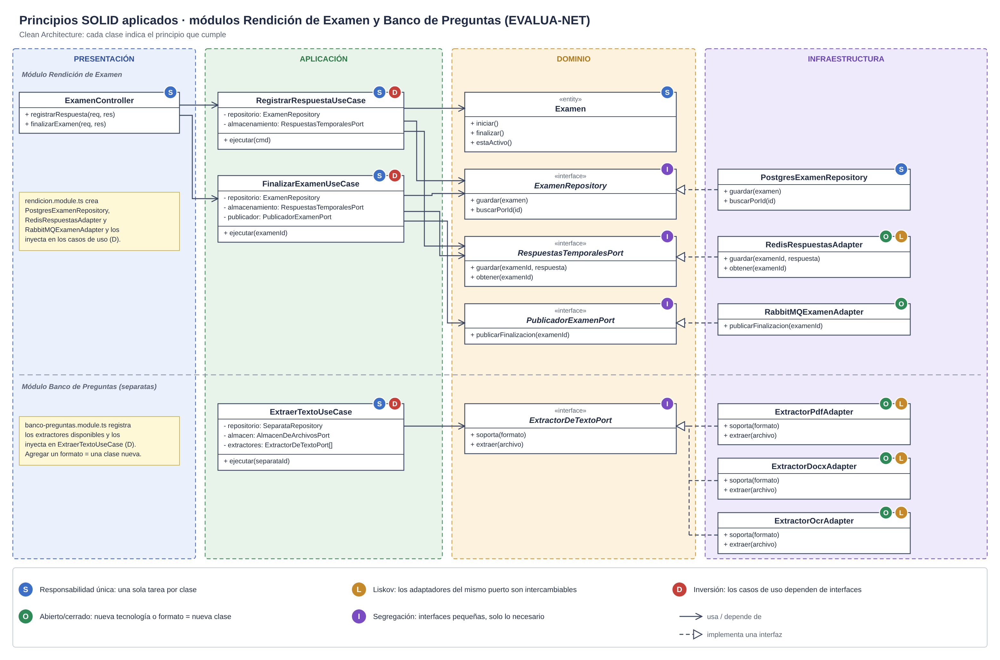

# Principios de diseño (SOLID)

**Proyecto:** EVALUA-NET – Sistema de simulacros de exámenes virtuales con IA – Academia Sofía

## Objetivo

Documentar cómo se aplicarán los principios SOLID en el backend de EVALUA-NET, organizado mediante Clean Architecture, para que cada módulo tenga responsabilidades claras, sea fácil de mantener y las reglas del negocio no dependan directamente de las tecnologías utilizadas.

## Contexto

- **Estilo arquitectónico:** Monolito modular con procesamiento asíncrono y servicio de IA independiente.
- **Enfoque interno:** Clean Architecture (presentación, aplicación, dominio e infraestructura).
- **Tecnología de referencia:** Node.js + TypeScript.
- **Módulo de referencia:** Rendición de Examen, porque integra el registro de respuestas, almacenamiento temporal con Redis, persistencia en PostgreSQL y procesamiento mediante RabbitMQ.
- **Módulo complementario:** Banco de Preguntas, porque la extracción de texto de las separatas (PDF, DOCX e imagen) muestra con claridad los principios abierto/cerrado y de sustitución de Liskov.

## SOLID en los módulos Rendición de Examen y Banco de Preguntas

El siguiente diagrama indica, junto a cada clase e interfaz, el principio SOLID que cumple.

**Descripción:** El diagrama muestra la separación de responsabilidades entre las capas. Los casos de uso dependen de interfaces y no de PostgreSQL, Redis, RabbitMQ ni de los extractores de texto. Las implementaciones concretas se crean y se conectan en la raíz de composición de cada módulo.

### Aplicación de los principios SOLID

| **Principio** | **Dónde se aplica (capa)** | **Cómo se cumple en EVALUA-NET** | **Archivos de referencia** |
|---|---|---|---|
| **S** · Responsabilidad única | Todas las capas | Cada clase tiene una función específica: el controlador recibe solicitudes, el caso de uso registra respuestas, la entidad valida las reglas del examen y el repositorio almacena los datos. | `examen.controller.ts`, `registrar-respuesta.use-case.ts`, `examen.ts`, `postgres-examen-repository.ts` |
| **O** · Abierto/cerrado | Infraestructura | Si se necesita cambiar Redis por otra tecnología de almacenamiento temporal, se crea un nuevo adaptador sin modificar el caso de uso. Lo mismo ocurre con las separatas: para aceptar un formato nuevo se agrega un extractor, sin modificar `ExtraerTextoUseCase`. | `respuestas-temporales.port.ts`, `redis-respuestas.adapter.ts`, `extractor-de-texto.port.ts`, `extractor-ocr.adapter.ts` |
| **L** · Sustitución de Liskov | Infraestructura | Cualquier adaptador que implemente `RespuestasTemporalesPort` debe permitir guardar y recuperar respuestas respetando el mismo contrato, sin alterar el funcionamiento del caso de uso. Los extractores de PDF, DOCX y OCR son intercambiables, porque todos cumplen `ExtractorDeTextoPort`. | `respuestas-temporales.port.ts`, `redis-respuestas.adapter.ts`, `extractor-pdf.adapter.ts`, `extractor-docx.adapter.ts` |
| **I** · Segregación de interfaces | Dominio y Aplicación | Cada interfaz contiene únicamente las operaciones necesarias: `ExamenRepository` permite guardar y buscar exámenes, `RespuestasTemporalesPort` permite almacenar y recuperar respuestas y `PublicadorExamenPort` solo publica la finalización. | `examen-repository.ts`, `respuestas-temporales.port.ts`, `publicador-examen.port.ts` |
| **D** · Inversión de dependencias | Aplicación | Los casos de uso reciben interfaces mediante sus constructores y no conocen directamente PostgreSQL, Redis ni los extractores. Las implementaciones concretas se conectan en la raíz de composición. | `registrar-respuesta.use-case.ts`, `rendicion.module.ts`, `extraer-texto.use-case.ts`, `banco-preguntas.module.ts` |

**Nota:** Los archivos corresponden al diseño propuesto del sistema y servirán como referencia durante su implementación.

## Qué pasaría sin SOLID en EVALUA-NET

| **Situación real** | **Sin SOLID** | **Con SOLID** |
|---|---|---|
| Se cambia Redis por otra tecnología | Se tendría que modificar el caso de uso que registra las respuestas. | Se implementa un nuevo adaptador que respete la misma interfaz. |
| Se cambia PostgreSQL | Las consultas SQL podrían estar mezcladas con las reglas del examen. | Se reemplaza la implementación del repositorio sin modificar las reglas del negocio. |
| Se quiere probar el registro de respuestas | Se necesitaría conectar el sistema a Redis y PostgreSQL. | Se pueden utilizar repositorios y adaptadores simulados. |
| Cambia una regla para finalizar el examen | Se tendría que buscar la validación en controladores y servicios. | La regla se modifica en la entidad `Examen`. |
| Se incorpora otro mecanismo de mensajería | Se modificarían directamente los casos de uso que publican eventos. | Se crea otro adaptador que implemente `PublicadorExamenPort`. |
| El docente sube una separata en un formato nuevo | El caso de uso tendría condicionales por cada formato y habría que modificarlo cada vez. | Se crea un extractor nuevo que implemente `ExtractorDeTextoPort`. |
| Se cambia el proveedor de IA | Habría que modificar los casos de uso que generan preguntas. | Se reemplaza el adaptador que implementa `GeneradorDePreguntasPort`. |

## Relación con Clean Architecture y los patrones

| **Principio** | **Lo cumple en el proyecto** |
|---|---|
| Responsabilidad única | La separación de responsabilidades entre Presentación, Aplicación, Dominio e Infraestructura. |
| Abierto/cerrado | Los patrones Adapter y Strategy, que permiten agregar nuevas implementaciones sin modificar los casos de uso. |
| Sustitución de Liskov | Los adaptadores que implementan una misma interfaz y mantienen su comportamiento esperado. |
| Segregación de interfaces | Los contratos específicos como `ExamenRepository`, `RespuestasTemporalesPort`, `PublicadorExamenPort` y `ExtractorDeTextoPort`. |
| Inversión de dependencias | Los patrones Repository y Dependency Injection, que permiten que los casos de uso dependan de interfaces y no de implementaciones concretas. |

## Para memorizar

| **Letra** | **Idea corta** | **Ejemplo en EVALUA-NET** |
|---|---|---|
| **S** | Una clase, una tarea. | El controlador recibe la solicitud; no calcula notas. |
| **O** | Se agrega código nuevo, no se modifica el existente. | Un extractor nuevo para otro formato de separata. |
| **L** | Los reemplazos deben comportarse igual. | Los extractores de PDF, DOCX y OCR son intercambiables. |
| **I** | Interfaces pequeñas. | `PublicadorExamenPort` solo publica la finalización. |
| **D** | Depender de interfaces, no de tecnologías. | `RegistrarRespuestaUseCase` usa `RespuestasTemporalesPort`, no Redis. |

## Beneficios

- Facilita el mantenimiento del sistema al separar las responsabilidades de cada clase.
- Permite cambiar tecnologías como PostgreSQL, Redis o RabbitMQ sin modificar las reglas del negocio, siempre que se respeten los contratos.
- Reduce el acoplamiento entre los componentes del backend.
- Facilita las pruebas mediante repositorios y adaptadores simulados.
- Permite aceptar nuevos formatos de separatas y cambiar el proveedor de IA sin afectar los casos de uso.
- Permite incorporar nuevas funcionalidades sin afectar innecesariamente el código existente.