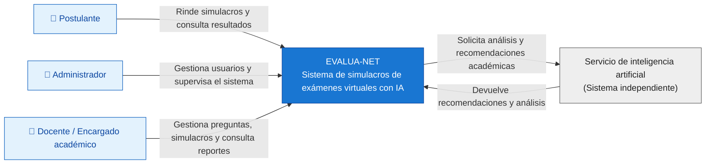

# Nivel 1 · Diagrama de contexto del sistema

> **Proyecto:** EVALUA-NET – Sistema de simulacros de exámenes virtuales con IA – Academia Sofía  
> **Modelo:** C4 · Nivel 1 de 4 · **Versión:** 1.0

---

## 1. Objetivo

Mostrar **EVALUA-NET como un único sistema**, identificando a las personas que lo utilizan y los sistemas externos con los que se comunica.

Este nivel proporciona una visión general del sistema, permitiendo comprender su propósito y sus principales interacciones sin mostrar detalles de su implementación.

| **Aspecto** | **Descripción** |
|---|---|
| Pregunta que responde | ¿Qué es EVALUA-NET, quiénes lo utilizan y con qué sistemas externos se relaciona? |
| Audiencia | Academia Sofía, docentes, administradores, equipo de desarrollo y operaciones. |
| Qué **no** muestra | Tecnologías, servidores, bases de datos, módulos internos ni clases. |
| Siguiente nivel | `Nivel2-Diagrama-de-Contenedores.md` |

---

## 2. Diagrama

El siguiente diagrama representa el contexto general de EVALUA-NET.

**Descripción:** EVALUA-NET es el sistema central que permite administrar y rendir simulacros virtuales. Los postulantes interactúan con el sistema para desarrollar sus evaluaciones, mientras que los administradores y encargados académicos gestionan su funcionamiento.

El servicio independiente de inteligencia artificial permite analizar el rendimiento académico y generar recomendaciones para los estudiantes.

---

## 3. Usuarios

| **Persona** | **Descripción** | **Qué hace en el sistema** |
|---|---|---|
| **Postulante** | Estudiante que se prepara para un examen de admisión. | Ingresa con sus credenciales, desarrolla simulacros, registra respuestas, consulta resultados, rankings y recomendaciones académicas. |
| **Administrador** | Responsable de gestionar y supervisar el funcionamiento del sistema. | Registra usuarios, asigna credenciales, administra permisos y supervisa las operaciones del sistema. |
| **Docente / Encargado académico** | Personal responsable de la preparación y organización de las evaluaciones. | Administra preguntas, configura simulacros y consulta reportes del rendimiento académico. |

> Los postulantes no realizan su matrícula ni sus pagos dentro de EVALUA-NET. Estos procesos se gestionan externamente por la academia.

---

## 4. Sistemas

| **Sistema** | **Tipo** | **Responsabilidad** | **Quién lo construye** |
|---|---|---|---|
| **EVALUA-NET** | Sistema en alcance | Permite gestionar simulacros virtuales, registrar respuestas, calcular resultados, generar rankings y consultar el rendimiento académico. | Equipo del proyecto. |
| **Servicio de inteligencia artificial** | Sistema independiente | Analiza los resultados académicos e identifica áreas de mejora para generar recomendaciones personalizadas. | Equipo del proyecto o proveedor del servicio de IA, según la implementación seleccionada. |

**Alcance:** PostgreSQL, Redis y RabbitMQ no se representan en este nivel porque son componentes tecnológicos internos de la solución. Se detallarán en el Nivel 2.

---  

## 5. Relaciones

| **Origen** | **Destino** | **Descripción** | **Protocolo** |
|---|---|---|---|
| Postulante | EVALUA-NET | Desarrolla simulacros, registra respuestas y consulta resultados, rankings y recomendaciones. | — |
| Administrador | EVALUA-NET | Gestiona usuarios, credenciales, permisos y supervisa el sistema. | — |
| Docente / Encargado académico | EVALUA-NET | Gestiona preguntas, configura simulacros y consulta reportes académicos. | — |
| EVALUA-NET | Servicio de inteligencia artificial | Envía información académica necesaria para generar análisis y recomendaciones. | HTTPS/REST (propuesto) |
| Servicio de inteligencia artificial | EVALUA-NET | Devuelve análisis del rendimiento y recomendaciones académicas. | Respuesta HTTPS/REST (propuesta) |

> En el Nivel 1 no se especifican los protocolos de comunicación entre las personas y EVALUA-NET. Estos detalles se presentarán en el Nivel 2.

---

## 6. Decisiones y supuestos

| **#** | **Decisión o supuesto** | **Motivo** |
|---|---|---|
| 1 | EVALUA-NET se representa como un único sistema. | El Nivel 1 del modelo C4 muestra el sistema completo sin detallar su estructura interna. |
| 2 | El servicio de inteligencia artificial se representa como un sistema independiente. | Permite diferenciar el sistema principal del componente encargado de generar análisis y recomendaciones. |
| 3 | Los postulantes utilizan credenciales asignadas por la academia. | El registro administrativo se realiza mediante personal autorizado. |
| 4 | EVALUA-NET no gestiona matrículas ni pagos. | Estos procesos se realizan fuera del alcance del sistema. |
| 5 | La comunicación con el servicio de IA se propone mediante una API REST. | Permite integrar ambos sistemas mediante una interfaz definida, manteniendo sus responsabilidades separadas. |
| 6 | No se muestran PostgreSQL, Redis ni RabbitMQ. | Son tecnologías internas que corresponden al Nivel 2 del modelo C4. |

### Pendientes por definir

| **Tema** | **Detalle** |
|---|---|
| Implementación del servicio de IA | Confirmar si será desarrollado por el equipo o si utilizará un proveedor externo. |
| Integración con el servicio de IA | Definir los datos que se enviarán, el formato de las respuestas y las medidas de seguridad. |
| Notificaciones | Confirmar si el sistema enviará avisos mediante correo electrónico u otro canal. Si requiere un proveedor externo, se incorporará al diagrama de contexto. |
| Roles académicos | Confirmar si el docente y el encargado académico tendrán los mismos permisos o roles separados. |

---

