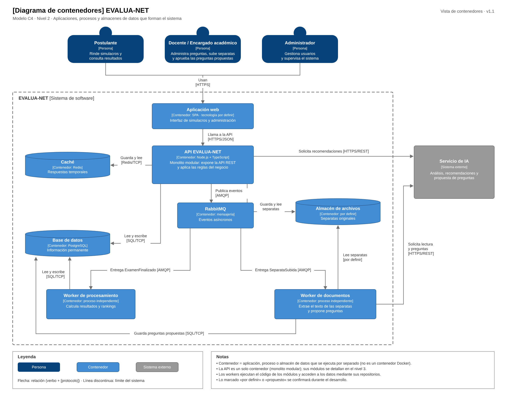

# Nivel 2 · Diagrama de contenedores

> **Proyecto:** EVALUA-NET – Sistema de simulacros de exámenes virtuales con IA – Academia Sofía  
> **Modelo:** C4 · Nivel 2 de 4 · **Versión:** 1.1

---

## 1. Objetivo

Abrir la caja **EVALUA-NET** del Nivel 1 y mostrar los contenedores que forman el sistema: las aplicaciones, los procesos y los almacenes de datos que funcionan de manera independiente, indicando sus tecnologías, responsabilidades y relaciones.

Este nivel permite comprender cómo se organiza técnicamente EVALUA-NET para gestionar simulacros virtuales, registrar respuestas, procesar resultados, procesar separatas y generar recomendaciones y propuestas de preguntas mediante inteligencia artificial.

| **Aspecto** | **Descripción** |
|---|---|
| Pregunta que responde | ¿De qué aplicaciones, procesos y almacenes de datos se compone EVALUA-NET y cómo se comunican? |
| Audiencia | Arquitectos de software, desarrolladores y responsables de infraestructura. |
| Qué es un contenedor | Una aplicación, proceso o almacén de datos que se ejecuta de forma independiente. No debe confundirse con un contenedor Docker. |
| Nivel anterior | `Nivel1-Diagrama-de-Contexto.md` |
| Siguiente nivel | `Nivel3-Diagrama-de-Componentes.md` |

---

## 2. Diagrama

El siguiente diagrama representa los principales contenedores de EVALUA-NET, sus tecnologías y las relaciones entre ellos.

El gráfico histórico agrupa Redis. Las tablas muestran la separación aprobada de las dos instancias en el Sprint 2.

**Leyenda:** azul oscuro = persona · azul = contenedor · gris = sistema externo · recuadro punteado = límite del sistema EVALUA-NET. Cada flecha indica la relación con su verbo y su [protocolo].

**Descripción:** Los usuarios acceden mediante una aplicación web que se comunica con la API principal. La API concentra las funcionalidades del monolito modular y utiliza PostgreSQL para la información permanente, Redis para datos temporales, el almacén de archivos para las separatas y RabbitMQ para distribuir tareas.

Los workers procesan eventos de forma asíncrona: uno calcula resultados y rankings, y otro extrae el texto de las separatas y propone preguntas con apoyo del servicio independiente de IA, que también proporciona las recomendaciones académicas.

> **Nota:** Los workers son procesos independientes que ejecutan el código de los módulos de la API (misma base de código). Acceden a los datos mediante los repositorios de cada módulo, no con consultas propias, y respetan la regla de que cada módulo usa solo sus tablas.

---

## 3. Contenedores

| **Contenedor** | **Tecnología** | **Responsabilidad** | **Datos que maneja** |
|---|---|---|---|
| **Aplicación web** | SPA React, TypeScript y Tailwind CSS, servida por nginx (ADR-014). | Proporciona las interfaces para rendir simulacros, gestionar preguntas y separatas, consultar resultados y administrar usuarios. | Estado de las pantallas y respuestas locales pendientes de sincronización. |
| **API EVALUA-NET** | Node.js + TypeScript (referencia). | Expone la API REST y ejecuta las reglas del negocio mediante un monolito modular. | Usuarios, preguntas, simulacros, respuestas, resultados y separatas. |
| **Base de datos principal** | PostgreSQL. | Almacena de forma permanente la información académica y administrativa. | Usuarios, preguntas, simulacros, respuestas definitivas, resultados, rankings y preguntas propuestas. |
| **Almacenamiento temporal de Rendición** | Redis con AOF. | Persiste temporalmente las marcas activas hasta su consolidación. | Marcas, revisiones y operaciones de idempotencia. |
| **Caché de consultas** | Redis independiente con expulsión LRU. | Cache-Aside con PostgreSQL como fuente definitiva. | Versiones visibles congeladas y catálogos autorizados de temas, cursos y sedes. |
| **Sistema de mensajería** | RabbitMQ. | Gestiona la comunicación asíncrona entre la API y los procesos en segundo plano. | Mensajes y eventos de exámenes finalizados y separatas subidas. |
| **Worker de procesamiento** | Proceso independiente; tecnología por definir. | Consume eventos y calcula resultados sin bloquear las solicitudes principales. | Exámenes finalizados, puntajes y resultados. |
| **Worker de documentos** | Proceso independiente; tecnología por definir. | Extrae el texto de las separatas (directo en Word y PDF con texto; con IA en imágenes y PDF escaneados) y genera propuestas de preguntas. | Separatas, texto extraído y preguntas propuestas pendientes de aprobación. |
| **Almacén de archivos** | Por definir. | Guarda las separatas originales fuera de la base de datos. | Archivos Word, PDF e imágenes subidos por los docentes. |

### Sistema independiente

| **Sistema** | **Tecnología** | **Responsabilidad** | **Datos que maneja** |
|---|---|---|---|
| **Servicio de inteligencia artificial** | Servicio independiente mediante API REST; implementación por definir. | Analiza el rendimiento y genera recomendaciones; lee imágenes y propone preguntas a partir de las separatas. | Información académica necesaria y contenido de las separatas. |

**Nota:** El servicio de IA se representa fuera del límite de EVALUA-NET, igual que en el Nivel 1. Los módulos de Gestión de Usuarios, Banco de Preguntas, Rendición de Examen, Procesamiento de Resultados, Ranking y Reportes y Analítica del Estudiante forman parte del backend modular y no se representan como contenedores independientes.

---

## 4. Relaciones

| **Origen** | **Destino** | **Descripción** | **Protocolo** |
|---|---|---|---|
| Postulante | Aplicación web | Desarrolla simulacros, registra respuestas y consulta resultados. | HTTPS |
| Administrador | Aplicación web | Gestiona usuarios, credenciales y permisos. | HTTPS |
| Docente / Encargado académico | Aplicación web | Administra preguntas, sube separatas, aprueba preguntas y consulta reportes. | HTTPS |
| Aplicación web | API EVALUA-NET | Envía solicitudes y recibe información del sistema. | HTTPS/JSON |
| API EVALUA-NET | PostgreSQL | Consulta y almacena información permanente. | SQL sobre TCP |
| API EVALUA-NET | Redis de Rendición | Guarda y recupera respuestas temporales. | Protocolo Redis sobre TCP |
| API EVALUA-NET | Redis de consultas | Lee y guarda proyecciones descartables. | Protocolo Redis sobre TCP |
| API EVALUA-NET | Almacén de archivos | Guarda y recupera las separatas subidas. | Por definir |
| API EVALUA-NET | RabbitMQ | Publica eventos de exámenes finalizados y separatas subidas. | AMQP |
| RabbitMQ | Worker de procesamiento | Entrega mensajes de exámenes finalizados. | AMQP |
| RabbitMQ | Worker de documentos | Entrega mensajes de separatas subidas. | AMQP |
| Worker de procesamiento | PostgreSQL | Consulta respuestas y almacena resultados procesados. | SQL sobre TCP |
| Worker de documentos | Almacén de archivos | Lee la separata original. | Por definir |
| Worker de documentos | PostgreSQL | Guarda las preguntas propuestas para revisión del docente. | SQL sobre TCP |
| Worker de documentos | Servicio de IA | Solicita la lectura de imágenes y la propuesta de preguntas. | HTTPS/REST (propuesto) |
| API EVALUA-NET | Servicio de IA | Solicita análisis del rendimiento y recomendaciones. | HTTPS/REST (propuesto) |
| Servicio de IA | API y Worker de documentos | Devuelve recomendaciones, texto leído y preguntas propuestas. | Respuesta HTTPS/REST (propuesta) |

> Las comunicaciones internas y los protocolos representan el diseño propuesto y deberán confirmarse durante el desarrollo.

---

## 5. Decisiones arquitectónicas reflejadas

| **Decisión** | **Alternativa descartada** | **Motivo** |
|---|---|---|
| **Backend como monolito modular** | Un microservicio por módulo. | Reduce la complejidad de desarrollo y despliegue, manteniendo los módulos separados internamente. |
| **Aplicación web separada del backend** | Integrar la interfaz en el servidor de aplicación. | Separa la presentación de las reglas del negocio y facilita el mantenimiento. |
| **PostgreSQL como base de datos principal** | Solo una base de datos NoSQL. | Mantiene la consistencia de usuarios, exámenes y resultados. |
| **Redis para almacenamiento temporal** | Guardar cada interacción directamente en PostgreSQL. | Reduce operaciones frecuentes sobre la base de datos principal. |
| **RabbitMQ para mensajería asíncrona** | Ejecutar todas las tareas dentro de las solicitudes HTTP. | No mantiene ocupada la API mientras se ejecutan las tareas. |
| **Workers para tareas en segundo plano** | Procesar todo dentro de la API. | Procesa resultados y separatas independientemente de las solicitudes de los usuarios. |
| **Almacén de archivos separado de PostgreSQL** | Guardar las separatas dentro de la base de datos. | Evita sobrecargar la base de datos con archivos y facilita su gestión (ADR-009). |
| **Extracción por tipo de archivo; IA solo para imágenes y escaneados** | Enviar todas las separatas a la IA. | Lee directamente Word y PDF con texto, reduce costos y errores, y el docente aprueba antes de incorporar preguntas (ADR-009). |
| **Servicio de IA independiente** | Incorporar la IA dentro del monolito. | Permite evolucionar la IA sin acoplarla al backend principal. |
| **API REST para la comunicación con IA** | Acceso directo del frontend a la IA. | Centraliza el control de acceso y evita exponer credenciales. |

### Consideraciones de despliegue

Docker podrá utilizarse para empaquetar las aplicaciones y procesos, y Kubernetes se contempla como orquestación. Estas tecnologías no modifican los límites de los contenedores C4: un contenedor C4 representa una aplicación o almacén de datos, no necesariamente un contenedor Docker.

---

## 6. Seguridad entre contenedores

| **Comunicación** | **Medida de seguridad** |
|---|---|
| Navegador → Aplicación web | Utilizar HTTPS para proteger la información transmitida. |
| Aplicación web → API EVALUA-NET | Autenticación mediante tokens y autorización según los roles. JWT es una alternativa propuesta. |
| API → PostgreSQL | Restringir el acceso a la red interna y utilizar credenciales protegidas. |
| API → Redis | Permitir conexiones autorizadas y restringir el acceso desde redes externas. |
| API → RabbitMQ | Utilizar usuarios, permisos y conexiones protegidas para publicar mensajes. |
| RabbitMQ → Workers | Restringir el consumo de mensajes a los procesos autorizados. |
| Workers → PostgreSQL | Utilizar credenciales con los permisos mínimos necesarios. |
| API → Almacén de archivos | Aceptar solo los formatos permitidos y el tamaño máximo definido, y restringir el acceso a los archivos. |
| Worker de documentos → Almacén de archivos | Permitir solo lectura de las separatas y restringir el acceso desde redes externas. |
| Worker de documentos → Servicio de IA | Utilizar HTTPS, autenticación entre servicios y enviar únicamente el contenido necesario de la separata. |
| API → Servicio de IA | Utilizar HTTPS, autenticación entre servicios y enviar únicamente la información académica necesaria. |
| Aplicación web → Almacenamiento local | Evitar guardar credenciales sensibles y proteger las respuestas pendientes de sincronización. |