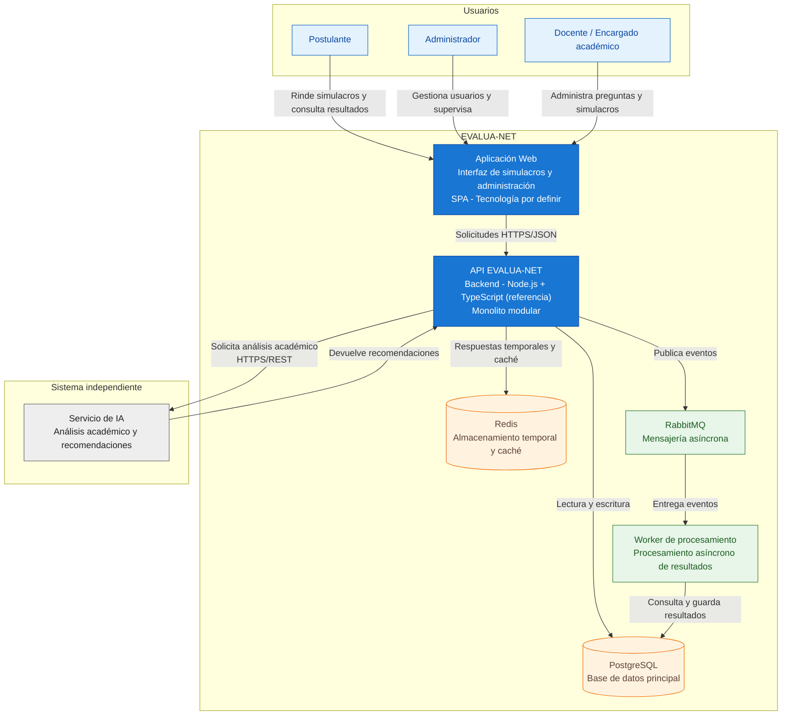

# Nivel 2 · Diagrama de contenedores

> **Proyecto:** EVALUA-NET – Sistema de simulacros de exámenes virtuales con IA – Academia Sofía  
> **Modelo:** C4 · Nivel 2 de 4 · **Versión:** 1.0

---

## 1. Objetivo

Abrir la caja **EVALUA-NET** del Nivel 1 y mostrar los contenedores que forman el sistema: las aplicaciones, los procesos y los almacenes de datos que funcionan de manera independiente, indicando sus tecnologías, responsabilidades y relaciones.

Este nivel permite comprender cómo se organiza técnicamente EVALUA-NET para gestionar simulacros virtuales, registrar respuestas, procesar resultados y generar recomendaciones académicas mediante inteligencia artificial.

| **Aspecto** | **Descripción** |
|---|---|
| Pregunta que responde | ¿De qué aplicaciones, procesos y almacenes de datos se compone EVALUA-NET y cómo se comunican? |
| Audiencia | Arquitectos de software, desarrolladores y responsables de infraestructura. |
| Qué es un contenedor | Una aplicación, proceso o almacén de datos que se ejecuta de forma independiente. No debe confundirse con un contenedor Docker. |
| Nivel anterior | `Nivel1-Diagrama-de-Contexto.md` |
| Siguiente nivel | `Nivel3-Diagrama-de-Componentes.md` |

---

## 2. Diagrama

El siguiente diagrama representa los principales contenedores de EVALUA-NET, sus tecnologías y las relaciones entre ellos.

**Descripción:** El diagrama muestra cómo los usuarios acceden a EVALUA-NET mediante una aplicación web que se comunica con la API principal.

La API concentra las funcionalidades del monolito modular y utiliza PostgreSQL para almacenar información permanente, Redis para datos temporales y RabbitMQ para distribuir tareas de procesamiento.

Los workers procesan eventos de manera asíncrona, mientras que el servicio independiente de IA proporciona análisis del rendimiento y recomendaciones académicas.

---

## 3. Contenedores

| **Contenedor** | **Tecnología** | **Responsabilidad** | **Datos que maneja** |
|---|---|---|---|
| **Aplicación web** | SPA; framework por definir. | Proporciona las interfaces para rendir simulacros, gestionar preguntas, consultar resultados y administrar usuarios. | Estado de las pantallas y respuestas locales pendientes de sincronización. |
| **API EVALUA-NET** | Node.js + TypeScript (tecnología de referencia). | Expone la API REST y ejecuta las reglas del negocio mediante un monolito modular. | Usuarios, preguntas, simulacros, respuestas y resultados mediante los servicios de almacenamiento. |
| **Base de datos principal** | PostgreSQL. | Almacena de forma permanente la información académica y administrativa del sistema. | Usuarios, preguntas, simulacros, respuestas definitivas, resultados y rankings. |
| **Almacenamiento temporal y caché** | Redis. | Almacena respuestas temporales durante los simulacros y permite acelerar determinadas consultas. | Respuestas temporales, información de sesión y datos de caché. |
| **Sistema de mensajería** | RabbitMQ. | Gestiona la comunicación asíncrona entre la API y los procesos encargados de tareas en segundo plano. | Mensajes y eventos relacionados con el procesamiento de exámenes. |
| **Worker de procesamiento** | Proceso independiente; tecnología por definir. | Consume eventos y ejecuta tareas de procesamiento de resultados sin bloquear las solicitudes principales. | Datos de exámenes finalizados, puntajes y resultados procesados. |

### Sistema independiente

| **Sistema** | **Tecnología** | **Responsabilidad** | **Datos que maneja** |
|---|---|---|---|
| **Servicio de inteligencia artificial** | Servicio independiente mediante API REST; implementación por definir. | Analiza el rendimiento académico e identifica debilidades para generar recomendaciones personalizadas. | Información académica necesaria para el análisis y recomendaciones generadas. |

**Nota:** El servicio de IA se representa fuera del límite principal de EVALUA-NET, manteniendo la misma clasificación utilizada en el diagrama de contexto del Nivel 1.

Los módulos de Gestión de Usuarios, Banco de Preguntas, Rendición de Examen, Procesamiento de Resultados, Ranking y Reportes y Analítica del Estudiante forman parte del backend modular. No se representan como contenedores independientes porque pertenecen a una misma aplicación.

---

## 4. Relaciones

| **Origen** | **Destino** | **Descripción** | **Protocolo** |
|---|---|---|---|
| Postulante | Aplicación web | Desarrolla simulacros, registra respuestas y consulta resultados. | HTTPS |
| Administrador | Aplicación web | Gestiona usuarios, credenciales y permisos. | HTTPS |
| Docente / Encargado académico | Aplicación web | Administra preguntas, configura simulacros y consulta reportes. | HTTPS |
| Aplicación web | API EVALUA-NET | Envía solicitudes y recibe información del sistema. | HTTPS/JSON |
| API EVALUA-NET | PostgreSQL | Consulta y almacena información permanente. | SQL sobre TCP |
| API EVALUA-NET | Redis | Guarda y recupera respuestas temporales y datos de caché. | Protocolo Redis sobre TCP |
| API EVALUA-NET | RabbitMQ | Publica eventos de exámenes finalizados y tareas pendientes. | AMQP |
| RabbitMQ | Worker de procesamiento | Entrega mensajes para ejecutar tareas asíncronas. | AMQP |
| Worker de procesamiento | PostgreSQL | Consulta respuestas definitivas y almacena resultados procesados. | SQL sobre TCP |
| API EVALUA-NET | Servicio de IA | Solicita análisis del rendimiento y recomendaciones académicas. | HTTPS/REST (propuesto) |
| Servicio de IA | API EVALUA-NET | Devuelve resultados del análisis y recomendaciones. | Respuesta HTTPS/REST (propuesta) |

> Las comunicaciones internas y los protocolos indicados representan el diseño propuesto. Los detalles de implementación deberán confirmarse durante el desarrollo.

---

## 5. Decisiones arquitectónicas reflejadas

| **Decisión** | **Alternativa descartada** | **Motivo** |
|---|---|---|
| **Backend como monolito modular** | Desarrollar cada módulo como un microservicio independiente. | Reduce la complejidad de desarrollo y despliegue, manteniendo los módulos organizados y separados internamente. |
| **Aplicación web separada del backend** | Integrar la interfaz directamente en el servidor de aplicación. | Permite separar la presentación de las reglas del negocio y facilitar su mantenimiento. |
| **PostgreSQL como base de datos principal** | Utilizar únicamente una base de datos NoSQL. | Permite almacenar información estructurada y mantener la consistencia de usuarios, exámenes y resultados. |
| **Redis para almacenamiento temporal** | Guardar cada interacción directamente en PostgreSQL. | Permite manejar respuestas temporales y reducir determinadas operaciones frecuentes sobre la base de datos principal. |
| **RabbitMQ para mensajería asíncrona** | Ejecutar todas las tareas dentro de las solicitudes HTTP. | Permite distribuir tareas de procesamiento sin mantener ocupada la API mientras se ejecutan. |
| **Workers para tareas en segundo plano** | Realizar todo el procesamiento dentro del proceso de la API. | Permite procesar resultados y otras tareas de forma independiente de las solicitudes de los usuarios. |
| **Servicio de IA independiente** | Incorporar toda la lógica de inteligencia artificial dentro del monolito. | Permite evolucionar la funcionalidad de IA sin acoplarla directamente al backend principal. |
| **API REST para la comunicación con IA** | Acceso directo del frontend al servicio de IA. | Centraliza el control de acceso y evita exponer directamente las credenciales o integraciones del servicio. |

### Consideraciones de despliegue

Docker podrá utilizarse para empaquetar las aplicaciones y procesos, mientras que Kubernetes se contempla como tecnología de orquestación según las decisiones de infraestructura del proyecto.

Estas tecnologías no modifican los límites de los contenedores C4: un contenedor C4 representa una aplicación o almacén de datos, no necesariamente un contenedor Docker.

---

## 6. Seguridad entre contenedores

| **Comunicación** | **Medida de seguridad** |
|---|---|
| Navegador → Aplicación web | Utilizar HTTPS para proteger la información transmitida. |
| Aplicación web → API EVALUA-NET | Autenticación mediante tokens y autorización según los roles del usuario. JWT es una alternativa propuesta. |
| API → PostgreSQL | Restringir el acceso a la red interna y utilizar credenciales protegidas. |
| API → Redis | Permitir conexiones autorizadas y restringir el acceso desde redes externas. |
| API → RabbitMQ | Utilizar usuarios, permisos y conexiones protegidas para publicar mensajes. |
| RabbitMQ → Worker | Restringir el consumo de mensajes a los procesos autorizados. |
| Worker → PostgreSQL | Utilizar credenciales con los permisos necesarios para consultar y registrar resultados. |
| API → Servicio de IA | Utilizar HTTPS, autenticación entre servicios y enviar únicamente la información académica necesaria. |
| Aplicación web → Almacenamiento local | Evitar guardar credenciales sensibles y proteger las respuestas pendientes de sincronización. |

