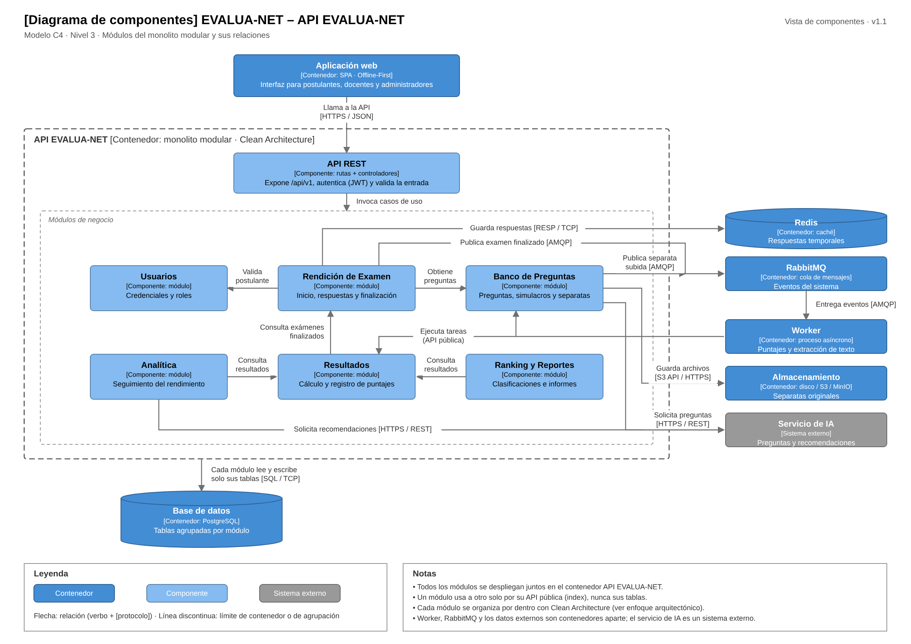

# Nivel 3 · Diagrama de componentes

> **Proyecto:** EVALUA-NET – Sistema de simulacros de exámenes virtuales con IA – Academia Sofía  
> **Contenedor detallado:** API EVALUA-NET  
> **Modelo:** C4 · Nivel 3 de 4 · **Versión:** 1.1

---

## 1. Objetivo

Abrir el contenedor **API EVALUA-NET** del Nivel 2 y mostrar sus componentes internos: los módulos del monolito modular, las responsabilidades de cada uno y las relaciones que mantienen entre sí y con los contenedores externos.

Este nivel permite comprender cómo se organiza el backend para gestionar usuarios, preguntas, separatas, simulacros, resultados, rankings y análisis del rendimiento académico.

| **Aspecto** | **Descripción** |
|---|---|
| Pregunta que responde | ¿Cómo se divide internamente la API EVALUA-NET y qué hace cada componente? |
| Audiencia | Arquitectos de software y desarrolladores. |
| Qué es un componente | Una unidad de software con una responsabilidad definida y una interfaz de comunicación. En este proyecto, cada módulo del monolito representa un componente principal. |
| Contenedor detallado | API EVALUA-NET. |
| Nivel anterior | `Nivel2-Diagrama-de-Contenedores.md` |
| Siguiente nivel | `Nivel4-Diagrama-de-Codigo.md` |

---

## 2. Diagrama

**Descripción:** El diagrama representa la organización interna del backend EVALUA-NET. La aplicación web llama a la API REST, que autentica, valida y dirige cada solicitud al módulo de negocio correspondiente.

Los módulos se comunican entre sí solo mediante sus APIs públicas y guardan su información en PostgreSQL, cada uno en sus propias tablas.

Rendición de Examen utiliza Redis para guardar respuestas temporales y publica en RabbitMQ el evento de examen finalizado. Banco de Preguntas guarda las separatas originales en el almacenamiento de archivos y publica el evento de separata subida.

El worker consume los eventos y ejecuta las tareas pidiéndoselas a los módulos mediante su API pública: calcular resultados y extraer el texto de las separatas. Banco de Preguntas y Analítica del Estudiante se comunican con el servicio de IA para obtener propuestas de preguntas y recomendaciones.

> **Nota:** El worker, RabbitMQ, Redis, PostgreSQL, el almacenamiento de archivos y el servicio de IA se muestran fuera del contenedor API. Sus conexiones representan relaciones de integración, no componentes internos del monolito.

---

## 3. Componentes

| **Componente** | **Responsabilidad** | **Funcionalidades principales** | **Carpeta en el código** |
|---|---|---|---|
| **API REST** | Punto de entrada HTTP del backend. | Rutas `/api/v1`, autenticación, autorización, validación de solicitudes y manejo de errores. | `src/api/` |
| **Gestión de Usuarios** | Administrar la identidad y el acceso al sistema. | Registro administrativo de usuarios, asignación de credenciales, autenticación y gestión de roles. | `src/modules/usuarios/` |
| **Banco de Preguntas** | Administrar las preguntas, las separatas y la configuración de simulacros. | Registro, actualización y clasificación de preguntas; configuración de evaluaciones; carga de separatas de los docentes, extracción de su texto y aprobación de las preguntas propuestas por la IA. | `src/modules/banco-preguntas/` |
| **Rendición de Examen** | Controlar el desarrollo de los simulacros virtuales. | Iniciar exámenes, registrar respuestas, controlar el estado y finalizar evaluaciones. | `src/modules/rendicion-examen/` |
| **Procesamiento de Resultados** | Calcular y almacenar los resultados de las evaluaciones. | Calificación de respuestas, cálculo de puntajes y registro de resultados. | `src/modules/resultados/` |
| **Ranking y Reportes** | Presentar clasificaciones e información académica. | Generación de rankings generales, por carrera y por sede, y elaboración de reportes. | `src/modules/ranking-reportes/` |
| **Analítica del Estudiante** | Evaluar el rendimiento académico de los postulantes. | Seguimiento del progreso, identificación de debilidades y consulta de recomendaciones generadas por IA. | `src/modules/analitica/` |

**Nota:** Las carpetas representan la organización propuesta del backend. Cada módulo deberá implementar sus funcionalidades respetando Clean Architecture.

El servicio independiente de IA no se incluye como módulo interno porque se ejecutará como un sistema separado.

---

## 4. Relaciones entre componentes

| **Origen** | **Destino** | **Descripción** | **Tipo de comunicación** |
|---|---|---|---|
| Aplicación web | API REST | Envía solicitudes para utilizar las funcionalidades del sistema. | HTTPS/JSON |
| API REST | Módulos de negocio | Invoca los casos de uso de cada módulo: usuarios, preguntas y separatas, exámenes, resultados, rankings y analítica. | Llamada interna |
| Rendición de Examen | Gestión de Usuarios | Verifica la identidad y autorización del postulante. | API pública del módulo |
| Rendición de Examen | Banco de Preguntas | Obtiene el identificador, la duración y la lista ordenada de preguntas del simulacro. El administrador general configura la selección con preguntas aprobadas y habilitadas. | API pública del módulo |
| Procesamiento de Resultados | Rendición de Examen | Obtiene los datos de los exámenes finalizados para su calificación. | API pública del módulo |
| Ranking y Reportes | Procesamiento de Resultados | Consulta los puntajes para generar clasificaciones. | API pública del módulo |
| Ranking y Reportes | Rendición de Examen | Obtiene las instantáneas de los intentos y el estado del cierre general para clasificar y medir participación. | API pública del módulo |
| Ranking y Reportes | Banco de Preguntas | Comprueba los cursos asignados antes de consultar agregados docentes. | API pública del módulo |
| Rendición de Examen | Gestión de Usuarios | Consulta la carrera, sede y condición al iniciar un intento. | API pública del módulo |
| Rendición de Examen | Procesamiento de Resultados | Comprueba que los intentos finalizados estén calificados antes de completar el cierre general. | API pública del módulo |
| Analítica del Estudiante | Procesamiento de Resultados | Consulta los resultados para analizar el rendimiento. | API pública del módulo |
| Worker | Procesamiento de Resultados | Pide calcular y registrar los resultados de un examen finalizado. | API pública del módulo |
| Worker | Banco de Preguntas | Pide extraer el texto de una separata y generar las preguntas propuestas. | API pública del módulo |

### Consideraciones de comunicación

- Los módulos del monolito se comunicarán mediante llamadas internas a interfaces públicas.
- Ningún módulo deberá acceder directamente a las clases privadas de otro módulo.
- Los procesos asíncronos se comunicarán mediante eventos publicados en RabbitMQ.
- El worker no escribe directamente en la base de datos: pide cada tarea al módulo dueño de los datos mediante su API pública.
- La comunicación con el servicio de IA se realizará mediante una interfaz de integración.
- Las relaciones representadas son las principales del diseño propuesto y podrán ampliarse durante la implementación.

---

## 5. Relaciones con contenedores y sistemas externos

| **Componente** | **Destino** | **Descripción** | **Protocolo** | **Patrón aplicado** |
|---|---|---|---|---|
| Todos los módulos | PostgreSQL | Cada módulo lee y escribe solo sus propias tablas (usuarios, preguntas y separatas, exámenes, resultados, rankings y analítica). | SQL sobre TCP | Repository |
| Rendición de Examen | Redis | Almacena y recupera respuestas temporales. | Protocolo Redis sobre TCP | Adapter |
| Rendición de Examen | RabbitMQ | Publica eventos de exámenes finalizados. | AMQP | Adapter |
| Banco de Preguntas | RabbitMQ | Publica el evento de separata subida. | AMQP | Adapter |
| Banco de Preguntas | Almacenamiento de archivos | Guarda la separata original (PDF, Word o imagen) fuera de la base de datos. | S3 API / HTTPS (por definir) | Adapter |
| Banco de Preguntas | Servicio independiente de IA | Solicita preguntas propuestas a partir del texto de la separata. | HTTPS/REST (propuesto) | Adapter |
| Analítica del Estudiante | Servicio independiente de IA | Solicita análisis y recomendaciones personalizadas. | HTTPS/REST (propuesto) | Adapter |
| RabbitMQ | Worker | Entrega los eventos para su procesamiento. | AMQP | Consumidor de mensajes |

### Procesamiento asíncrono de resultados

1. El postulante finaliza un simulacro.
2. Rendición de Examen guarda las respuestas definitivas en PostgreSQL.
3. Se publica un evento de examen finalizado en RabbitMQ.
4. Un worker independiente consume el evento.
5. El worker invoca la API pública de Procesamiento de Resultados.
6. Procesamiento de Resultados calcula los puntajes y los almacena en PostgreSQL.
7. El worker de Ranking y Reportes compara el estado persistido con la proyección y publica en RabbitMQ los simulacros que requieren actualización. Las consultas leen la proyección de PostgreSQL. Analítica del Estudiante utiliza los resultados disponibles.

### Procesamiento asíncrono de separatas

1. El docente sube una separata (PDF, Word o imagen).
2. Banco de Preguntas valida el archivo, lo guarda en el almacenamiento y registra la separata.
3. Se publica un evento de separata subida en RabbitMQ.
4. Un worker consume el evento e invoca a Banco de Preguntas.
5. Banco de Preguntas extrae el texto según el formato (lectura directa u OCR) y solicita preguntas propuestas al servicio de IA.
6. Las preguntas quedan como propuestas; solo pasan al banco cuando el docente las revisa y aprueba.

Estos mecanismos permiten ejecutar tareas de procesamiento sin bloquear innecesariamente las solicitudes principales de la API.

La implementación deberá garantizar la entrega confiable de eventos y evitar procesar dos veces el mismo examen o la misma separata.

---

## 6. Reglas del monolito modular

| **#** | **Regla** | **Motivo** |
|---|---|---|
| 1 | Todos los módulos de negocio se ejecutan dentro del contenedor API EVALUA-NET. | Mantiene el estilo de monolito modular con un backend principal. |
| 2 | Un módulo se comunica con otro únicamente mediante su API pública (`index.ts`). | Evita dependencias directas con clases o archivos internos de otros módulos. |
| 3 | Cada módulo administra sus propias entidades, repositorios y operaciones de persistencia. | Mantiene la separación de responsabilidades y evita el acceso directo a los datos internos de otros módulos. |
| 4 | Los módulos no deben modificar directamente las tablas pertenecientes a otros módulos, ni siquiera desde un worker. | Reduce el acoplamiento y protege la consistencia de la información. |
| 5 | Cada módulo se organiza internamente mediante Clean Architecture. | Separa las reglas del negocio de las tecnologías y facilita las pruebas. |
| 6 | Las operaciones de infraestructura se realizan mediante interfaces y adaptadores. | Permite cambiar tecnologías sin modificar directamente los casos de uso. |
| 7 | Las tareas asíncronas se procesan mediante RabbitMQ y workers independientes. | Evita ejecutar tareas prolongadas dentro de las solicitudes HTTP. |
| 8 | El servicio de IA se integra mediante una interfaz definida y no forma parte del monolito. | Permite evolucionar la inteligencia artificial de manera independiente. |
| 9 | Los módulos no gestionan matrículas ni pagos. | Estas actividades están fuera del alcance funcional de EVALUA-NET. |
| 10 | Los componentes deben mantener contratos claros y responsabilidades específicas. | Facilita el mantenimiento y la evolución del sistema. |
| 11 | La IA solo propone preguntas y recomendaciones; el docente aprueba las preguntas y la nota oficial se calcula con reglas deterministas. | Mantiene el control humano y la confiabilidad de los resultados. |

### Relación con Clean Architecture

Cada módulo del backend se organizará utilizando las siguientes capas:

| **Capa** | **Responsabilidad** |
|---|---|
| Presentación | Recibir solicitudes HTTP, validar datos de entrada y devolver respuestas. |
| Aplicación | Coordinar los casos de uso y las operaciones del módulo. |
| Dominio | Contener las entidades, las reglas del negocio y los puertos (interfaces). |
| Infraestructura | Implementar repositorios, adaptadores y conexiones con tecnologías externas. |

Esta organización permitirá mantener una estructura consistente en todos los módulos de EVALUA-NET.

---

## 7. Leyenda

- **Azul:** contenedor. **Celeste:** componente (módulo). **Gris:** sistema externo.
- **Flecha:** relación con verbo y [protocolo]. **Línea discontinua:** límite del contenedor o de la agrupación de módulos.

### Versión del simulacro (RC10)

El Banco conserva la versión congelada al primer intento. Rendición obtiene la duración y las preguntas ordenadas sin claves, y Procesamiento de Resultados consulta las claves congeladas mediante un contrato interno separado. Las ediciones posteriores al banco no cambian la versión usada en rendición. Véase la [SDD de Rendición](../../specs/rendicion-examen/spec.md#decisiones-aprobadas).
