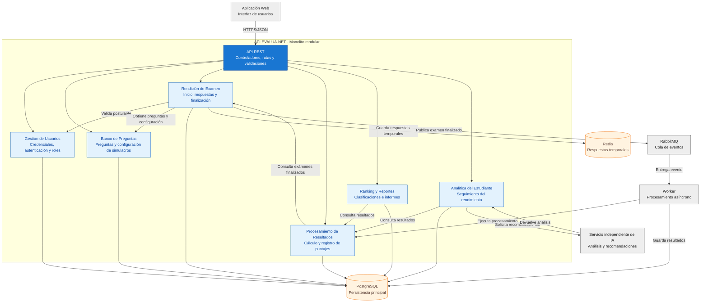

# Nivel 3 · Diagrama de componentes

> **Proyecto:** EVALUA-NET – Sistema de simulacros de exámenes virtuales con IA – Academia Sofía  
> **Contenedor detallado:** API EVALUA-NET  
> **Modelo:** C4 · Nivel 3 de 4 · **Versión:** 1.0

---

## 1. Objetivo

Abrir el contenedor **API EVALUA-NET** del Nivel 2 y mostrar sus componentes internos: los módulos del monolito modular, las responsabilidades de cada uno y las relaciones que mantienen entre sí y con los contenedores externos.

Este nivel permite comprender cómo se organiza el backend para gestionar usuarios, preguntas, simulacros, resultados, rankings y análisis del rendimiento académico.

| **Aspecto** | **Descripción** |
|---|---|
| Pregunta que responde | ¿Cómo se divide internamente la API EVALUA-NET y qué hace cada componente? |
| Audiencia | Arquitectos de software y desarrolladores. |
| Qué es un componente | Una unidad de software con una responsabilidad definida y una interfaz de comunicación. En este proyecto, cada módulo del monolito representa un componente principal. |
| Contenedor detallado | API EVALUA-NET. |
| Nivel anterior | `Nivel2-Diagrama-de-Contenedores.md` |
| Siguiente nivel | `Nivel4-Diagrama-de-Codigo.md` |

---

## 2. Diagrama

El siguiente diagrama muestra los componentes internos de la API EVALUA-NET y sus principales relaciones.

**Descripción:** El diagrama representa la organización interna del backend EVALUA-NET. La API REST recibe las solicitudes de la aplicación web y las dirige hacia los módulos correspondientes.

Los módulos se comunican mediante interfaces internas y utilizan PostgreSQL para almacenar información permanente.

El módulo Rendición de Examen utiliza Redis para guardar respuestas temporales y RabbitMQ para publicar eventos de exámenes finalizados.

Los workers consumen estos eventos y ejecutan el procesamiento correspondiente. Por su parte, Analítica del Estudiante se comunica con el servicio independiente de IA para obtener recomendaciones académicas.

> **Nota:** El worker, RabbitMQ, Redis, PostgreSQL y el servicio de IA se muestran como elementos externos al contenedor API. Sus conexiones representan relaciones de integración, no componentes internos del monolito.

---

## 3. Componentes

| **Componente** | **Responsabilidad** | **Funcionalidades principales** | **Carpeta en el código** |
|---|---|---|---|
| **API REST** | Punto de entrada HTTP del backend. | Rutas `/api/v1`, autenticación, autorización, validación de solicitudes y manejo de errores. | `src/api/` |
| **Gestión de Usuarios** | Administrar la identidad y el acceso al sistema. | Registro administrativo de usuarios, asignación de credenciales, autenticación y gestión de roles. | `src/modules/usuarios/` |
| **Banco de Preguntas** | Administrar las preguntas y la configuración de simulacros. | Registro, actualización, clasificación de preguntas y configuración de evaluaciones. | `src/modules/banco-preguntas/` |
| **Rendición de Examen** | Controlar el desarrollo de los simulacros virtuales. | Iniciar exámenes, registrar respuestas, controlar el estado y finalizar evaluaciones. | `src/modules/rendicion-examen/` |
| **Procesamiento de Resultados** | Calcular y almacenar los resultados de las evaluaciones. | Calificación de respuestas, cálculo de puntajes y registro de resultados. | `src/modules/resultados/` |
| **Ranking y Reportes** | Presentar clasificaciones e información académica. | Generación de rankings generales, por carrera y por sede, y elaboración de reportes. | `src/modules/ranking-reportes/` |
| **Analítica del Estudiante** | Evaluar el rendimiento académico de los postulantes. | Seguimiento del progreso, identificación de debilidades y consulta de recomendaciones generadas por IA. | `src/modules/analitica/` |

**Nota:** Las carpetas representan la organización propuesta del backend. Cada módulo deberá implementar sus funcionalidades respetando Clean Architecture.

El servicio independiente de IA no se incluye como módulo interno porque se ejecutará como un sistema separado.

---

## 4. Relaciones entre componentes

| **Origen** | **Destino** | **Descripción** | **Tipo de comunicación** |
|---|---|---|---|
| Aplicación web | API REST | Envía solicitudes para utilizar las funcionalidades del sistema. | HTTPS/JSON |
| API REST | Gestión de Usuarios | Solicita autenticación, autorización y administración de usuarios. | Llamada interna |
| API REST | Banco de Preguntas | Solicita operaciones sobre preguntas y simulacros. | Llamada interna |
| API REST | Rendición de Examen | Solicita iniciar, registrar respuestas y finalizar exámenes. | Llamada interna |
| API REST | Procesamiento de Resultados | Consulta los resultados académicos disponibles. | Llamada interna |
| API REST | Ranking y Reportes | Solicita clasificaciones y reportes. | Llamada interna |
| API REST | Analítica del Estudiante | Consulta el progreso y las recomendaciones académicas. | Llamada interna |
| Rendición de Examen | Gestión de Usuarios | Verifica la identidad y autorización del postulante. | API pública del módulo |
| Rendición de Examen | Banco de Preguntas | Obtiene la configuración y las preguntas del simulacro. | API pública del módulo |
| Procesamiento de Resultados | Rendición de Examen | Obtiene los datos de los exámenes finalizados para su calificación. | API pública del módulo |
| Ranking y Reportes | Procesamiento de Resultados | Consulta los puntajes para generar clasificaciones. | API pública del módulo |
| Analítica del Estudiante | Procesamiento de Resultados | Consulta los resultados para analizar el rendimiento. | API pública del módulo |

### Consideraciones de comunicación

- Los módulos del monolito se comunicarán mediante llamadas internas a interfaces públicas.
- Ningún módulo deberá acceder directamente a las clases privadas de otro módulo.
- Los procesos asíncronos se comunicarán mediante eventos publicados en RabbitMQ.
- La comunicación con el servicio de IA se realizará mediante una interfaz de integración.
- Las relaciones representadas son las principales del diseño propuesto y podrán ampliarse durante la implementación.

---

## 5. Relaciones con contenedores y sistemas externos

| **Componente** | **Destino** | **Descripción** | **Protocolo** | **Patrón aplicado** |
|---|---|---|---|---|
| Gestión de Usuarios | PostgreSQL | Almacena usuarios, credenciales protegidas y roles. | SQL sobre TCP | Repository |
| Banco de Preguntas | PostgreSQL | Almacena preguntas y configuraciones de simulacros. | SQL sobre TCP | Repository |
| Rendición de Examen | PostgreSQL | Registra exámenes y respuestas definitivas. | SQL sobre TCP | Repository |
| Rendición de Examen | Redis | Almacena y recupera respuestas temporales. | Protocolo Redis sobre TCP | Adapter |
| Rendición de Examen | RabbitMQ | Publica eventos de exámenes finalizados. | AMQP | Adapter |
| Procesamiento de Resultados | PostgreSQL | Consulta información y almacena puntajes calculados. | SQL sobre TCP | Repository |
| Ranking y Reportes | PostgreSQL | Consulta resultados para elaborar rankings y reportes. | SQL sobre TCP | Repository |
| Analítica del Estudiante | PostgreSQL | Consulta información histórica del rendimiento académico. | SQL sobre TCP | Repository |
| Analítica del Estudiante | Servicio independiente de IA | Solicita análisis y recomendaciones personalizadas. | HTTPS/REST (propuesto) | Adapter |

### Procesamiento asíncrono

El procesamiento de resultados se realizará mediante el siguiente flujo:

1. El postulante finaliza un simulacro.
2. Rendición de Examen guarda las respuestas definitivas en PostgreSQL.
3. Se publica un evento de examen finalizado en RabbitMQ.
4. Un worker independiente consume el evento.
5. El worker ejecuta la lógica de Procesamiento de Resultados.
6. Los resultados calculados se almacenan en PostgreSQL.
7. Ranking y Reportes y Analítica del Estudiante utilizan los resultados disponibles.

Este mecanismo permite ejecutar tareas de procesamiento sin bloquear innecesariamente las solicitudes principales de la API.

La implementación deberá garantizar la entrega confiable de eventos y evitar procesar dos veces el mismo examen.

---

## 6. Reglas del monolito modular

| **#** | **Regla** | **Motivo** |
|---|---|---|
| 1 | Todos los módulos de negocio se ejecutan dentro del contenedor API EVALUA-NET. | Mantiene el estilo de monolito modular con un backend principal. |
| 2 | Un módulo se comunica con otro únicamente mediante su API pública (`index.ts`). | Evita dependencias directas con clases o archivos internos de otros módulos. |
| 3 | Cada módulo administra sus propias entidades, repositorios y operaciones de persistencia. | Mantiene la separación de responsabilidades y evita el acceso directo a los datos internos de otros módulos. |
| 4 | Los módulos no deben modificar directamente las tablas pertenecientes a otros módulos. | Reduce el acoplamiento y protege la consistencia de la información. |
| 5 | Cada módulo se organiza internamente mediante Clean Architecture. | Separa las reglas del negocio de las tecnologías y facilita las pruebas. |
| 6 | Las operaciones de infraestructura se realizan mediante interfaces y adaptadores. | Permite cambiar tecnologías sin modificar directamente los casos de uso. |
| 7 | Las tareas asíncronas se procesan mediante RabbitMQ y workers independientes. | Evita ejecutar tareas prolongadas dentro de las solicitudes HTTP. |
| 8 | El servicio de IA se integra mediante una interfaz definida y no forma parte del monolito. | Permite evolucionar la inteligencia artificial de manera independiente. |
| 9 | Los módulos no gestionan matrículas ni pagos. | Estas actividades están fuera del alcance funcional de EVALUA-NET. |
| 10 | Los componentes deben mantener contratos claros y responsabilidades específicas. | Facilita el mantenimiento y la evolución del sistema. |

### Relación con Clean Architecture

Cada módulo del backend se organizará utilizando las siguientes capas:

| **Capa** | **Responsabilidad** |
|---|---|
| Presentación | Recibir solicitudes HTTP, validar datos de entrada y devolver respuestas. |
| Aplicación | Coordinar los casos de uso y las operaciones del módulo. |
| Dominio | Contener las entidades y reglas del negocio. |
| Infraestructura | Implementar repositorios, adaptadores y conexiones con tecnologías externas. |

Esta organización permitirá mantener una estructura consistente en todos los módulos de EVALUA-NET.

---

