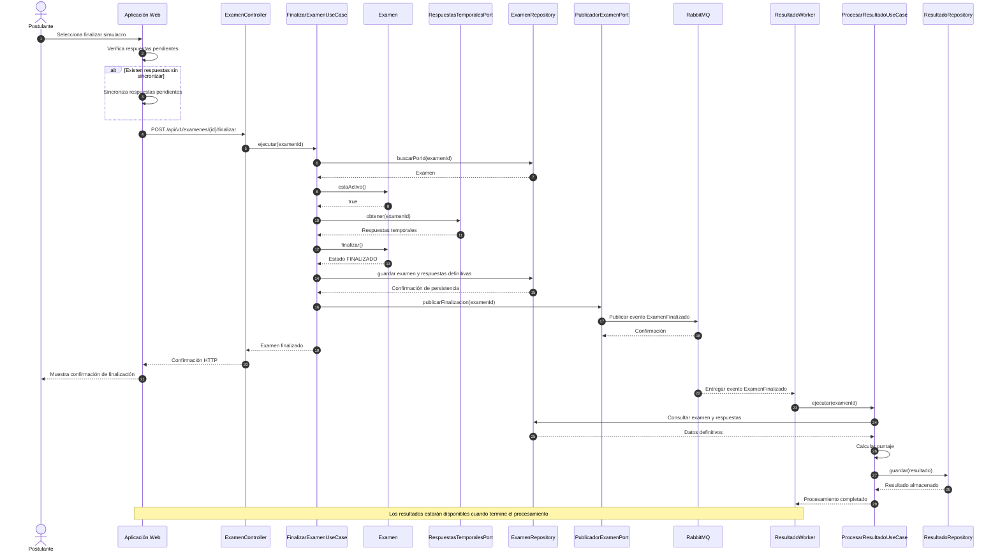

# Nivel 4 · Diagrama de código

> **Proyecto:** EVALUA-NET – Sistema de simulacros de exámenes virtuales con IA – Academia Sofía  
> **Módulos detallados:** Rendición de Examen y Procesamiento de Resultados  
> **Modelo:** C4 · Nivel 4 de 4 · **Notación:** UML · **Versión:** 1.0

---

## 1. Objetivo

Mostrar **cómo está organizado el código** de los componentes más importantes de EVALUA-NET, identificando sus clases, interfaces, responsabilidades y relaciones.

Se detalla el flujo **Finalizar simulacro y procesar resultados**, que involucra al módulo Rendición de Examen, el procesamiento asíncrono de resultados y la integración con PostgreSQL, Redis y RabbitMQ.

Este nivel permite comprender cómo se aplican Clean Architecture, los patrones de diseño y los principios SOLID en el código del sistema.

| **Aspecto** | **Descripción** |
|---|---|
| Pregunta que responde | ¿Qué clases e interfaces existen dentro de los módulos y cómo colaboran entre sí? |
| Audiencia | Desarrolladores y arquitectos de software. |
| Notación | UML mediante diagramas de clases y secuencia. |
| Módulos detallados | Rendición de Examen y Procesamiento de Resultados. |
| Por qué estos módulos | Son fundamentales para registrar respuestas, finalizar simulacros y calcular los resultados académicos. |
| Nivel anterior | `Nivel3-Diagrama-de-Componentes.md` |

---

## 2. Diagrama de clases

El siguiente diagrama representa las principales clases e interfaces propuestas para los módulos Rendición de Examen y Procesamiento de Resultados.

Se utiliza Clean Architecture para separar las reglas del negocio de los detalles tecnológicos.

```mermaid
classDiagram
    direction TB

    namespace Presentacion {
        class ExamenController {
            +iniciarExamen()
            +registrarRespuesta()
            +finalizarExamen()
        }
    }

    namespace Aplicacion {
        class IniciarExamenUseCase {
            +ejecutar(examenId)
        }

        class RegistrarRespuestaUseCase {
            +ejecutar(command)
        }

        class FinalizarExamenUseCase {
            +ejecutar(examenId)
        }

        class ProcesarResultadoUseCase {
            +ejecutar(examenId)
        }

        class RespuestasTemporalesPort {
            <<interface>>
            +guardar(examenId, respuesta)
            +obtener(examenId)
        }

        class PublicadorExamenPort {
            <<interface>>
            +publicarFinalizacion(examenId)
        }
    }

    namespace Dominio {
        class Examen {
            +string id
            +string postulanteId
            +string simulacroId
            -EstadoExamen estado
            +iniciar()
            +finalizar()
            +estaActivo() boolean
        }

        class Respuesta {
            +string preguntaId
            +string alternativaId
            +Date fechaRegistro
        }

        class EstadoExamen {
            <<enumeration>>
            PENDIENTE
            EN_CURSO
            FINALIZADO
        }

        class Resultado {
            +string examenId
            +number puntaje
            +number respuestasCorrectas
            +number respuestasIncorrectas
            +calcularPuntaje()
        }

        class ExamenRepository {
            <<interface>>
            +guardar(examen)
            +buscarPorId(id)
        }

        class ResultadoRepository {
            <<interface>>
            +guardar(resultado)
            +buscarPorExamen(examenId)
        }
    }

    namespace Infraestructura {
        class PostgresExamenRepository {
            +guardar(examen)
            +buscarPorId(id)
        }

        class PostgresResultadoRepository {
            +guardar(resultado)
            +buscarPorExamen(examenId)
        }

        class RedisRespuestasAdapter {
            +guardar(examenId, respuesta)
            +obtener(examenId)
        }

        class RabbitMQExamenAdapter {
            +publicarFinalizacion(examenId)
        }

        class ResultadoWorker {
            +procesarMensaje(examenId)
        }
    }

    ExamenController --> IniciarExamenUseCase
    ExamenController --> RegistrarRespuestaUseCase
    ExamenController --> FinalizarExamenUseCase

    IniciarExamenUseCase --> ExamenRepository
    RegistrarRespuestaUseCase --> ExamenRepository
    RegistrarRespuestaUseCase --> RespuestasTemporalesPort

    FinalizarExamenUseCase --> ExamenRepository
    FinalizarExamenUseCase --> RespuestasTemporalesPort
    FinalizarExamenUseCase --> PublicadorExamenPort

    Examen --> EstadoExamen
    Examen "1" o-- "0..*" Respuesta

    ProcesarResultadoUseCase --> ExamenRepository
    ProcesarResultadoUseCase --> ResultadoRepository
    ProcesarResultadoUseCase ..> Resultado

    PostgresExamenRepository ..|> ExamenRepository
    PostgresResultadoRepository ..|> ResultadoRepository
    RedisRespuestasAdapter ..|> RespuestasTemporalesPort
    RabbitMQExamenAdapter ..|> PublicadorExamenPort

    ResultadoWorker --> ProcesarResultadoUseCase
```

**Descripción:** El diagrama muestra cómo los controladores utilizan los casos de uso para ejecutar las funcionalidades del sistema.

Las entidades Examen, Respuesta y Resultado contienen la información y las reglas principales del negocio.

Los repositorios y adaptadores permiten trabajar con PostgreSQL, Redis y RabbitMQ sin que los casos de uso dependan directamente de estas tecnologías.

El procesamiento de resultados se ejecuta mediante un worker independiente que consume los eventos publicados cuando un examen finaliza.

### 2.1. Capas de Clean Architecture

| **Capa** | **Contiene** | **Regla** |
|---|---|---|
| **Presentación** | Controladores y rutas HTTP. | Recibe solicitudes y las traduce a llamadas de los casos de uso. |
| **Aplicación** | Casos de uso, comandos y puertos. | Coordina las operaciones del sistema sin depender de tecnologías concretas. |
| **Dominio** | Entidades, enumeraciones y contratos de persistencia. | Contiene las reglas del negocio y no depende de las capas externas. |
| **Infraestructura** | Repositorios, adaptadores y workers. | Implementa las interfaces utilizando tecnologías concretas. |

> **Regla de dependencia:** Las clases de Aplicación dependen de contratos internos y no de implementaciones concretas. Infraestructura implementa esos contratos y el Dominio permanece independiente de PostgreSQL, Redis y RabbitMQ.

### 2.2. Clases del módulo Rendición de Examen

| **Clase** | **Tipo** | **Capa** | **Responsabilidad** |
|---|---|---|---|
| `ExamenController` | Controlador | Presentación | Recibe solicitudes para iniciar, registrar respuestas y finalizar exámenes. |
| `IniciarExamenUseCase` | Caso de uso | Aplicación | Verifica las condiciones necesarias e inicia un simulacro. |
| `RegistrarRespuestaUseCase` | Caso de uso | Aplicación | Valida el examen y coordina el registro temporal de respuestas. |
| `FinalizarExamenUseCase` | Caso de uso | Aplicación | Recupera las respuestas, finaliza el examen y solicita su procesamiento. |
| `Examen` | Entidad | Dominio | Controla las reglas y los estados del examen. |
| `Respuesta` | Entidad u objeto de valor | Dominio | Representa la respuesta registrada para una pregunta. |
| `EstadoExamen` | Enumeración | Dominio | Define los estados PENDIENTE, EN_CURSO y FINALIZADO. |
| `ExamenRepository` | Interfaz | Dominio | Define las operaciones para guardar y consultar exámenes. |
| `RespuestasTemporalesPort` | Interfaz | Aplicación | Define las operaciones para almacenar y recuperar respuestas temporales. |
| `PublicadorExamenPort` | Interfaz | Aplicación | Define la publicación de eventos de exámenes finalizados. |
| `PostgresExamenRepository` | Repositorio | Infraestructura | Implementa la persistencia de exámenes mediante PostgreSQL. |
| `RedisRespuestasAdapter` | Adaptador | Infraestructura | Implementa el almacenamiento temporal de respuestas con Redis. |
| `RabbitMQExamenAdapter` | Adaptador | Infraestructura | Publica eventos mediante RabbitMQ. |

### 2.3. Clases del módulo Procesamiento de Resultados

| **Clase** | **Tipo** | **Capa** | **Responsabilidad** |
|---|---|---|---|
| `ProcesarResultadoUseCase` | Caso de uso | Aplicación | Coordina la calificación de un examen finalizado. |
| `Resultado` | Entidad | Dominio | Representa el puntaje y los resultados obtenidos por el postulante. |
| `ResultadoRepository` | Interfaz | Dominio | Define las operaciones para guardar y consultar resultados. |
| `PostgresResultadoRepository` | Repositorio | Infraestructura | Implementa el almacenamiento permanente de resultados en PostgreSQL. |
| `ResultadoWorker` | Consumidor de eventos | Infraestructura | Recibe eventos de RabbitMQ e invoca el caso de uso de procesamiento. |

**Nota:** Las clases presentadas forman parte del diseño propuesto. Los nombres y métodos servirán como referencia durante la implementación del backend.

### 2.4. Notación UML utilizada

| **Símbolo** | **Significado** | **Ejemplo** |
|---|---|---|
| Línea continua con flecha | Asociación o dependencia de uso. | `ExamenController` → `FinalizarExamenUseCase` |
| Línea discontinua con flecha | Dependencia temporal entre clases. | `ProcesarResultadoUseCase` → `Resultado` |
| Línea discontinua con triángulo hueco | Realización o implementación de una interfaz. | `RedisRespuestasAdapter` implementa `RespuestasTemporalesPort`. |
| Rombo vacío | Agregación entre elementos. | `Examen` contiene referencias a respuestas. |
| `<<interface>>` | Define un contrato sin implementación concreta. | `ExamenRepository` |
| `<<enumeration>>` | Define un conjunto de valores posibles. | `EstadoExamen` |
| `+` | Método o atributo público. | `+ finalizar()` |
| `-` | Atributo o método privado. | `- estado` |

---

## 3. Diagrama de secuencia: finalizar simulacro y procesar resultados

El siguiente diagrama representa cómo interactúan las clases y los componentes cuando un postulante finaliza un simulacro.

**Descripción:** El proceso comienza cuando el postulante solicita finalizar su simulacro.

El sistema verifica que las respuestas estén sincronizadas, recupera la información temporal desde Redis y registra el cierre del examen en PostgreSQL.

Después publica un evento en RabbitMQ para que un worker ejecute el cálculo de resultados.

El procesamiento se realiza de manera asíncrona, evitando mantener abierta la solicitud HTTP durante toda la calificación.

### 3.1. Pasos del flujo

| **Paso** | **Origen → Destino** | **Acción** |
|---|---|---|
| 1 | Postulante → Aplicación web | Solicita finalizar el simulacro. |
| 2 | Aplicación web → API | Envía la solicitud de finalización cuando las respuestas pendientes están sincronizadas. |
| 3 | `ExamenController` → `FinalizarExamenUseCase` | Ejecuta el caso de uso correspondiente. |
| 4 | `FinalizarExamenUseCase` → `ExamenRepository` | Consulta el examen que se desea finalizar. |
| 5 | `FinalizarExamenUseCase` → `Examen` | Verifica que el examen esté activo. |
| 6 | `FinalizarExamenUseCase` → `RespuestasTemporalesPort` | Recupera las respuestas almacenadas temporalmente. |
| 7 | `FinalizarExamenUseCase` → `Examen` | Cambia el estado del examen a FINALIZADO. |
| 8 | `FinalizarExamenUseCase` → `ExamenRepository` | Guarda el examen y sus respuestas definitivas. |
| 9 | `FinalizarExamenUseCase` → `PublicadorExamenPort` | Solicita publicar el evento de finalización. |
| 10 | `RabbitMQExamenAdapter` → RabbitMQ | Publica el evento `ExamenFinalizado`. |
| 11 | RabbitMQ → `ResultadoWorker` | Entrega el evento al proceso encargado de calcular resultados. |
| 12 | `ResultadoWorker` → `ProcesarResultadoUseCase` | Ejecuta el procesamiento del examen. |
| 13 | `ProcesarResultadoUseCase` → `ExamenRepository` | Consulta las respuestas definitivas. |
| 14 | `ProcesarResultadoUseCase` → `Resultado` | Calcula el puntaje según las reglas del simulacro. |
| 15 | `ProcesarResultadoUseCase` → `ResultadoRepository` | Guarda el resultado obtenido. |
| 16 | `ResultadoRepository` → PostgreSQL | Almacena el puntaje y la información del resultado. |

### 3.2. Flujos alternativos

| **Situación** | **Comportamiento esperado** |
|---|---|
| El examen ya está finalizado. | El sistema evita finalizarlo nuevamente y devuelve el estado actual. |
| Existen respuestas sin sincronizar. | La aplicación intenta sincronizarlas antes de solicitar el cierre. |
| Redis no está disponible. | El sistema registra el error y evita confirmar una finalización incompleta. |
| PostgreSQL presenta un error. | No se confirma la finalización hasta que se guarden los datos definitivos. |
| RabbitMQ no está disponible. | El evento debe quedar pendiente para su publicación posterior, mediante un mecanismo confiable como Transactional Outbox. |
| El worker recibe un evento repetido. | Se evita generar resultados duplicados mediante controles de idempotencia. |
| El procesamiento falla. | El mensaje podrá reintentarse y el error deberá quedar registrado para su seguimiento. |

**Consideración:** La sincronización y el cierre deben protegerse frente a solicitudes simultáneas. Además, el procesamiento asíncrono debe cumplir los tiempos de respuesta definidos en los atributos de calidad del proyecto.

---

## 4. Patrones y principios que se ven en este nivel

| **Elemento del diagrama** | **Patrón o principio** |
|---|---|
| `ExamenRepository` y `PostgresExamenRepository` | Patrón **Repository**. |
| `ResultadoRepository` y `PostgresResultadoRepository` | Patrón **Repository**. |
| `RedisRespuestasAdapter` | Patrón **Adapter**. |
| `RabbitMQExamenAdapter` | Patrón **Adapter**. |
| Los casos de uso reciben interfaces mediante constructores. | **Dependency Injection** e inversión de dependencias (SOLID). |
| Los controladores, casos de uso, entidades y repositorios tienen responsabilidades separadas. | Responsabilidad única (SOLID). |
| Los adaptadores implementan contratos que pueden sustituirse por otras implementaciones compatibles. | Abierto/cerrado y sustitución de Liskov (SOLID). |
| `ExamenRepository`, `ResultadoRepository` y `RespuestasTemporalesPort` definen operaciones específicas. | Segregación de interfaces (SOLID). |
| `ResultadoWorker` consume eventos sin bloquear la API principal. | Procesamiento asíncrono mediante mensajería. |
| Los módulos se comunican mediante contratos públicos. | Regla del monolito modular. |

### Relación con los documentos del proyecto

| **Documento** | **Relación con el Nivel 4** |
|---|---|
| `../03-diseno-de-software/diseno-interno-de-modulos.md` | Define la organización de carpetas, las capas y las clases del módulo Rendición de Examen. |
| `../03-diseno-de-software/patrones-de-diseno.md` | Describe los patrones Repository, Adapter y Dependency Injection utilizados en el diseño. |
| `../03-diseno-de-software/principios-de-diseno.md` | Explica cómo se aplican los principios SOLID. |
| `Nivel3-Diagrama-de-Componentes.md` | Presenta los módulos de Rendición de Examen y Procesamiento de Resultados dentro de la API EVALUA-NET. |

---

## 5. Decisiones de implementación

| **#** | **Decisión** | **Justificación** |
|---|---|---|
| 1 | Utilizar Clean Architecture dentro de los módulos. | Mantiene separadas las reglas del negocio y los detalles tecnológicos. |
| 2 | Definir interfaces para la persistencia y las integraciones. | Reduce el acoplamiento y facilita las pruebas. |
| 3 | Utilizar Redis para almacenar respuestas temporales. | Permite gestionar las respuestas activas sin depender exclusivamente de consultas frecuentes a PostgreSQL. |
| 4 | Guardar las respuestas definitivas en PostgreSQL. | Permite mantener un registro persistente de las evaluaciones realizadas. |
| 5 | Utilizar RabbitMQ para publicar eventos de finalización. | Permite distribuir tareas de procesamiento de manera asíncrona. |
| 6 | Ejecutar el cálculo de resultados mediante workers. | Separa el procesamiento de las solicitudes HTTP principales. |
| 7 | Evitar el procesamiento duplicado de exámenes. | Protege la consistencia de los resultados cuando existen reintentos o mensajes repetidos. |
| 8 | Mantener una API pública por módulo. | Evita dependencias directas entre implementaciones internas del monolito. |

> **Nota:** Estas decisiones describen el diseño propuesto. Los detalles de implementación, manejo de errores y transacciones deberán completarse durante el desarrollo.

---

