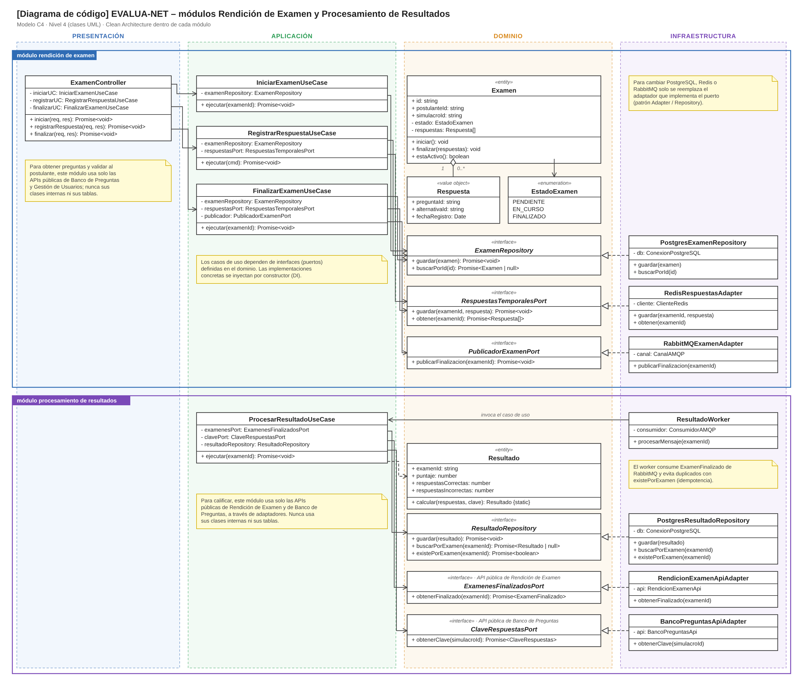
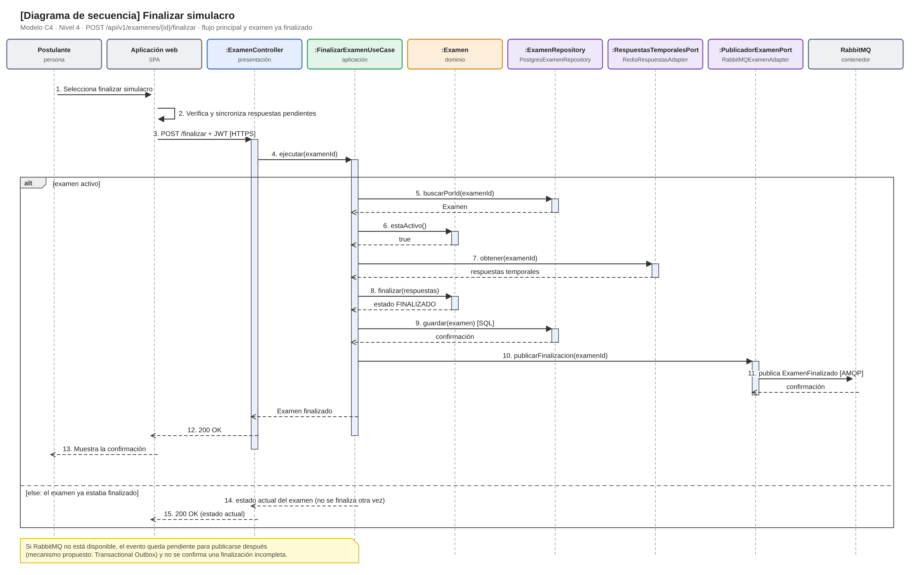
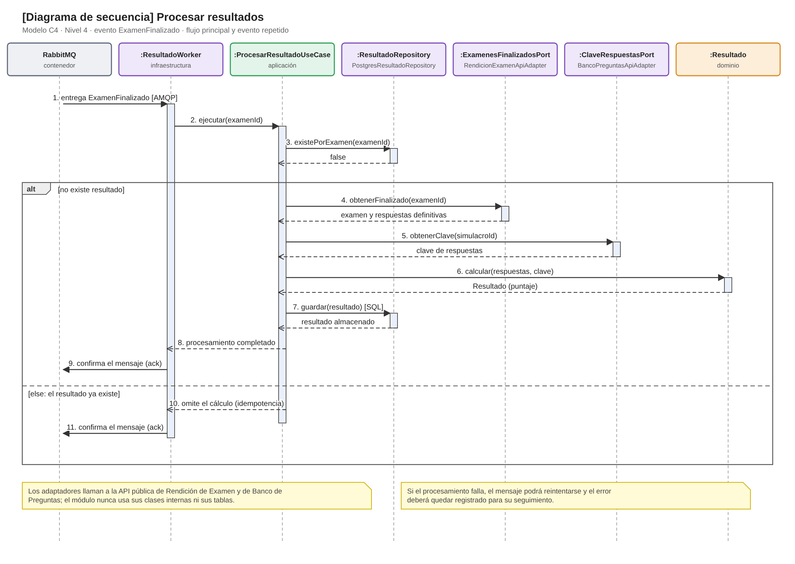

# Nivel 4 · Diagrama de código

> **Proyecto:** EVALUA-NET – Sistema de simulacros de exámenes virtuales con IA – Academia Sofía  
> **Módulos detallados:** Rendición de Examen y Procesamiento de Resultados  
> **Modelo:** C4 · Nivel 4 de 4 · **Notación:** UML · **Versión:** 1.1

---

## 1. Objetivo

Mostrar **cómo está organizado el código** de los componentes más importantes de EVALUA-NET, identificando sus clases, interfaces, responsabilidades y relaciones.

Se detalla el flujo **Finalizar simulacro y procesar resultados**, que involucra al módulo Rendición de Examen, el procesamiento asíncrono de resultados y la integración con PostgreSQL, Redis y RabbitMQ.

Este nivel permite comprender cómo se aplican Clean Architecture, los patrones de diseño y los principios SOLID en el código del sistema.

| **Aspecto** | **Descripción** |
|---|---|
| Pregunta que responde | ¿Qué clases e interfaces existen dentro de los módulos y cómo colaboran entre sí? |
| Audiencia | Desarrolladores y arquitectos de software. |
| Notación | UML mediante diagramas de clases y secuencia. |
| Módulos detallados | Rendición de Examen y Procesamiento de Resultados. |
| Por qué estos módulos | Son fundamentales para registrar respuestas, finalizar simulacros y calcular los resultados académicos. |
| Nivel anterior | `Nivel3-Diagrama-de-Componentes.md` |

---

## 2. Diagrama de clases

El diagrama representa las principales clases e interfaces propuestas para los dos módulos, organizadas por capa de Clean Architecture (columnas) y por módulo (bandas).

**Descripción:** Los controladores utilizan los casos de uso para ejecutar las funcionalidades. Las entidades Examen, Respuesta y Resultado contienen la información y las reglas principales del negocio. Los repositorios y adaptadores permiten trabajar con PostgreSQL, Redis y RabbitMQ sin que los casos de uso dependan de estas tecnologías.

Los módulos no comparten clases internas ni tablas: Procesamiento de Resultados obtiene los datos del examen y la clave de respuestas mediante puertos, cuyos adaptadores llaman a las APIs públicas de Rendición de Examen y de Banco de Preguntas.

El procesamiento de resultados se ejecuta mediante un worker independiente que consume los eventos publicados cuando un examen finaliza.

### 2.1. Capas de Clean Architecture

| **Capa** | **Contiene** | **Regla** |
|---|---|---|
| **Presentación** | Controladores y rutas HTTP. | Recibe solicitudes y las traduce a llamadas de los casos de uso. |
| **Aplicación** | Casos de uso y comandos. | Coordina las operaciones del sistema sin depender de tecnologías concretas. |
| **Dominio** | Entidades, enumeraciones, repositorios y puertos (interfaces). | Contiene las reglas del negocio y no depende de las capas externas. |
| **Infraestructura** | Repositorios, adaptadores y workers. | Implementa las interfaces utilizando tecnologías concretas. |

> **Regla de dependencia:** Las clases de Aplicación dependen de contratos del Dominio y no de implementaciones concretas. Infraestructura implementa esos contratos y el Dominio permanece independiente de PostgreSQL, Redis y RabbitMQ.

### 2.2. Clases del módulo Rendición de Examen

| **Clase** | **Tipo** | **Capa** | **Responsabilidad** |
|---|---|---|---|
| `ExamenController` | Controlador | Presentación | Recibe solicitudes para iniciar, registrar respuestas y finalizar exámenes. |
| `IniciarExamenUseCase` | Caso de uso | Aplicación | Verifica las condiciones necesarias e inicia un simulacro. |
| `RegistrarRespuestaUseCase` | Caso de uso | Aplicación | Valida el examen y coordina el registro temporal de respuestas. |
| `FinalizarExamenUseCase` | Caso de uso | Aplicación | Recupera las respuestas, finaliza el examen y solicita su procesamiento. |
| `Examen` | Entidad | Dominio | Controla las reglas y los estados del examen; contiene sus respuestas. |
| `Respuesta` | Objeto de valor | Dominio | Representa la respuesta registrada para una pregunta. |
| `EstadoExamen` | Enumeración | Dominio | Define los estados PENDIENTE, EN_CURSO y FINALIZADO. |
| `ExamenRepository` | Interfaz | Dominio | Define las operaciones para guardar y consultar exámenes. |
| `RespuestasTemporalesPort` | Interfaz (puerto) | Dominio | Define las operaciones para almacenar y recuperar respuestas temporales. |
| `PublicadorExamenPort` | Interfaz (puerto) | Dominio | Define la publicación de eventos de exámenes finalizados. |
| `PostgresExamenRepository` | Repositorio | Infraestructura | Implementa la persistencia de exámenes mediante PostgreSQL. |
| `RedisRespuestasAdapter` | Adaptador | Infraestructura | Implementa el almacenamiento temporal de respuestas con Redis. |
| `RabbitMQExamenAdapter` | Adaptador | Infraestructura | Publica eventos mediante RabbitMQ. |

### 2.3. Clases del módulo Procesamiento de Resultados

| **Clase** | **Tipo** | **Capa** | **Responsabilidad** |
|---|---|---|---|
| `ProcesarResultadoUseCase` | Caso de uso | Aplicación | Coordina la calificación de un examen finalizado y evita duplicados. |
| `Resultado` | Entidad | Dominio | Representa el puntaje y los resultados obtenidos; calcula la nota con reglas deterministas. |
| `ResultadoRepository` | Interfaz | Dominio | Guarda y consulta resultados, e indica si ya existe uno para un examen. |
| `ExamenesFinalizadosPort` | Interfaz (puerto) | Dominio | Obtiene el examen finalizado desde la API pública de Rendición de Examen. |
| `ClaveRespuestasPort` | Interfaz (puerto) | Dominio | Obtiene la clave de respuestas desde la API pública de Banco de Preguntas. |
| `PostgresResultadoRepository` | Repositorio | Infraestructura | Implementa el almacenamiento permanente de resultados en PostgreSQL. |
| `RendicionExamenApiAdapter` | Adaptador | Infraestructura | Implementa `ExamenesFinalizadosPort` llamando a la API pública de Rendición de Examen. |
| `BancoPreguntasApiAdapter` | Adaptador | Infraestructura | Implementa `ClaveRespuestasPort` llamando a la API pública de Banco de Preguntas. |
| `ResultadoWorker` | Consumidor de eventos | Infraestructura | Recibe eventos de RabbitMQ e invoca el caso de uso de procesamiento. |

**Nota:** Las clases presentadas forman parte del diseño propuesto. Los nombres y métodos servirán como referencia durante la implementación del backend.

### 2.4. Notación UML utilizada

| **Símbolo** | **Significado** | **Ejemplo** |
|---|---|---|
| Línea continua con flecha abierta | Asociación o dependencia de uso. | `ExamenController` → `FinalizarExamenUseCase` |
| Línea discontinua con flecha abierta | Dependencia de creación. | `ProcesarResultadoUseCase` → `Resultado` |
| Línea discontinua con triángulo hueco | Realización o implementación de una interfaz. | `RedisRespuestasAdapter` implementa `RespuestasTemporalesPort`. |
| Rombo vacío | Agregación entre elementos. | `Examen` contiene respuestas (`0..*`). |
| `«interface»`, `«enumeration»`, `«entity»`, `«value object»` | Estereotipo del tipo de clase. | `ExamenRepository`, `EstadoExamen` |
| `+` / `-` | Miembro público / privado. | `+ finalizar()`, `- estado` |

---

## 3. Diagramas de secuencia

El flujo completo se divide en dos diagramas: la finalización del simulacro (síncrona) y el procesamiento de resultados (asíncrono).

### 3.1. Finalizar simulacro

**Descripción:** El postulante solicita finalizar su simulacro. La aplicación sincroniza las respuestas pendientes y llama a la API. El caso de uso verifica que el examen esté activo, recupera las respuestas temporales desde Redis, finaliza el examen, guarda los datos definitivos en PostgreSQL y publica el evento `ExamenFinalizado` en RabbitMQ. La solicitud HTTP termina sin esperar el cálculo del resultado.

| **Paso** | **Origen → Destino** | **Acción** |
|---|---|---|
| 1-2 | Postulante → Aplicación web | Solicita finalizar; la aplicación sincroniza las respuestas pendientes. |
| 3 | Aplicación web → `ExamenController` | Envía `POST /api/v1/examenes/{id}/finalizar` con JWT. |
| 4 | `ExamenController` → `FinalizarExamenUseCase` | Ejecuta el caso de uso. |
| 5 | `FinalizarExamenUseCase` → `ExamenRepository` | Consulta el examen. |
| 6 | `FinalizarExamenUseCase` → `Examen` | Verifica que esté activo. |
| 7 | `FinalizarExamenUseCase` → `RespuestasTemporalesPort` | Recupera las respuestas temporales. |
| 8 | `FinalizarExamenUseCase` → `Examen` | Finaliza el examen con sus respuestas (estado FINALIZADO). |
| 9 | `FinalizarExamenUseCase` → `ExamenRepository` | Guarda el examen y sus respuestas definitivas. |
| 10-11 | `FinalizarExamenUseCase` → `PublicadorExamenPort` → RabbitMQ | Publica el evento `ExamenFinalizado`. |
| 12-13 | `ExamenController` → Aplicación web → Postulante | Confirma la finalización. |
| 14-15 | Flujo alternativo | Si el examen ya estaba finalizado, devuelve el estado actual sin finalizarlo de nuevo. |

### 3.2. Procesar resultados

**Descripción:** El worker recibe el evento e invoca el caso de uso. Si aún no existe un resultado para ese examen, el caso de uso obtiene el examen finalizado y la clave de respuestas mediante puertos (que llaman a las APIs públicas de los otros módulos), calcula el puntaje con la entidad `Resultado` y lo guarda en PostgreSQL. Si el resultado ya existe, omite el cálculo y confirma el mensaje.

| **Paso** | **Origen → Destino** | **Acción** |
|---|---|---|
| 1-2 | RabbitMQ → `ResultadoWorker` → `ProcesarResultadoUseCase` | Entrega el evento y ejecuta el procesamiento. |
| 3 | `ProcesarResultadoUseCase` → `ResultadoRepository` | Verifica si ya existe un resultado para el examen (idempotencia). |
| 4 | `ProcesarResultadoUseCase` → `ExamenesFinalizadosPort` | Obtiene el examen y sus respuestas definitivas. |
| 5 | `ProcesarResultadoUseCase` → `ClaveRespuestasPort` | Obtiene la clave de respuestas del simulacro. |
| 6 | `ProcesarResultadoUseCase` → `Resultado` | Calcula el puntaje con las reglas del simulacro. |
| 7 | `ProcesarResultadoUseCase` → `ResultadoRepository` | Guarda el resultado en PostgreSQL. |
| 8-9 | `ResultadoWorker` → RabbitMQ | Informa que terminó y confirma el mensaje (ack). |
| 10-11 | Flujo alternativo | Si el resultado ya existe, omite el cálculo y confirma el mensaje. |

### 3.3. Flujos alternativos

| **Situación** | **Comportamiento esperado** |
|---|---|
| El examen ya está finalizado. | El sistema evita finalizarlo nuevamente y devuelve el estado actual. |
| Existen respuestas sin sincronizar. | La aplicación intenta sincronizarlas antes de solicitar el cierre. |
| Redis no está disponible. | El sistema registra el error y evita confirmar una finalización incompleta. |
| PostgreSQL presenta un error. | No se confirma la finalización hasta que se guarden los datos definitivos. |
| RabbitMQ no está disponible. | El evento debe quedar pendiente para su publicación posterior, mediante un mecanismo confiable como Transactional Outbox (propuesto). |
| El worker recibe un evento repetido. | `existePorExamen` evita generar resultados duplicados (idempotencia). |
| El procesamiento falla. | El mensaje podrá reintentarse y el error deberá quedar registrado para su seguimiento. |

**Consideración:** La sincronización y el cierre deben protegerse frente a solicitudes simultáneas. Además, el procesamiento asíncrono debe cumplir los tiempos de respuesta definidos en los atributos de calidad del proyecto.

---

## 4. Patrones y principios que se ven en este nivel

| **Elemento del diagrama** | **Patrón o principio** |
|---|---|
| `ExamenRepository` / `PostgresExamenRepository` y `ResultadoRepository` / `PostgresResultadoRepository` | Patrón **Repository**. |
| `RedisRespuestasAdapter`, `RabbitMQExamenAdapter`, `RendicionExamenApiAdapter` y `BancoPreguntasApiAdapter` | Patrón **Adapter**. |
| Los casos de uso reciben interfaces mediante constructores. | **Dependency Injection** e inversión de dependencias (SOLID). |
| Controladores, casos de uso, entidades y repositorios tienen responsabilidades separadas. | Responsabilidad única (SOLID). |
| Los adaptadores implementan contratos que pueden sustituirse por otras implementaciones. | Abierto/cerrado y sustitución de Liskov (SOLID). |
| Los puertos y repositorios definen operaciones específicas. | Segregación de interfaces (SOLID). |
| `ResultadoWorker` consume eventos sin bloquear la API principal. | Procesamiento asíncrono mediante mensajería. |
| Un módulo usa a otro solo mediante su API pública, a través de un puerto. | Regla del monolito modular. |

### Relación con los documentos del proyecto

| **Documento** | **Relación con el Nivel 4** |
|---|---|
| `../03-diseno-de-software/diseno-interno-de-modulos.md` | Define la organización de carpetas, las capas y las clases del módulo Rendición de Examen. |
| `../03-diseno-de-software/patrones-de-diseno.md` | Describe los patrones Repository, Adapter y Dependency Injection utilizados en el diseño. |
| `../03-diseno-de-software/principios-de-diseno.md` | Explica cómo se aplican los principios SOLID. |
| `Nivel3-Diagrama-de-Componentes.md` | Presenta los módulos de Rendición de Examen y Procesamiento de Resultados dentro de la API EVALUA-NET. |

---

## 5. Decisiones de implementación

| **#** | **Decisión** | **Justificación** |
|---|---|---|
| 1 | Utilizar Clean Architecture dentro de los módulos. | Mantiene separadas las reglas del negocio y los detalles tecnológicos. |
| 2 | Definir interfaces (puertos) en el Dominio para la persistencia y las integraciones. | Reduce el acoplamiento y facilita las pruebas. |
| 3 | Utilizar Redis para almacenar respuestas temporales. | Permite gestionar las respuestas activas sin depender de consultas frecuentes a PostgreSQL. |
| 4 | Guardar las respuestas definitivas en PostgreSQL. | Permite mantener un registro persistente de las evaluaciones realizadas. |
| 5 | Utilizar RabbitMQ para publicar eventos de finalización. | Permite distribuir tareas de procesamiento de manera asíncrona. |
| 6 | Ejecutar el cálculo de resultados mediante workers. | Separa el procesamiento de las solicitudes HTTP principales. |
| 7 | Evitar el procesamiento duplicado con `existePorExamen`. | Protege la consistencia de los resultados ante reintentos o mensajes repetidos. |
| 8 | Mantener una API pública por módulo y consumirla mediante puertos y adaptadores. | Evita dependencias directas entre implementaciones internas del monolito. |

> **Nota:** Estas decisiones describen el diseño propuesto. Los detalles de implementación, manejo de errores y transacciones deberán completarse durante el desarrollo.

---